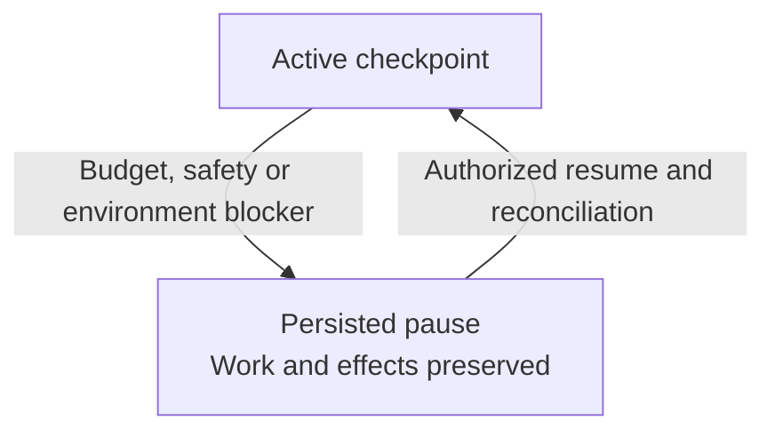
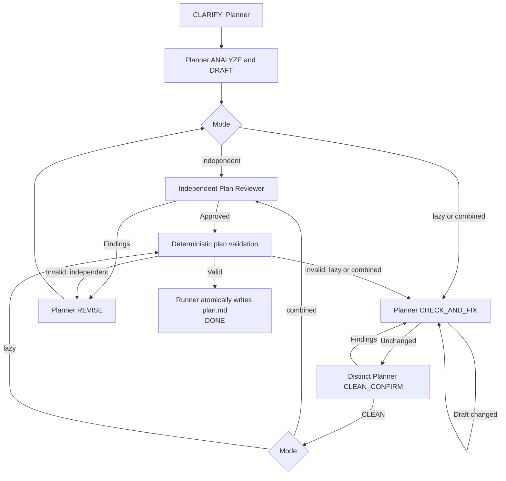
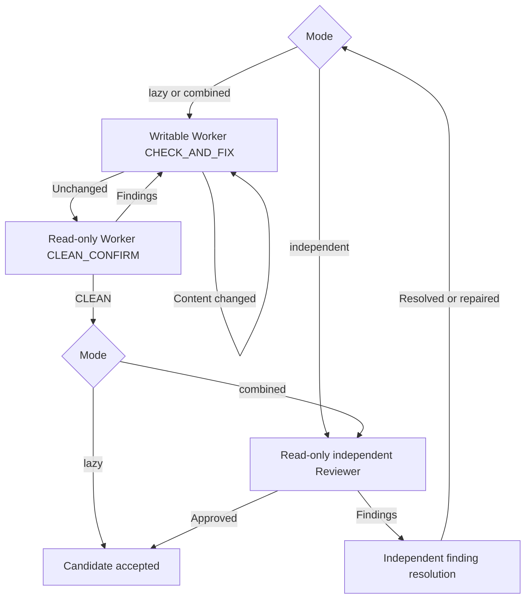
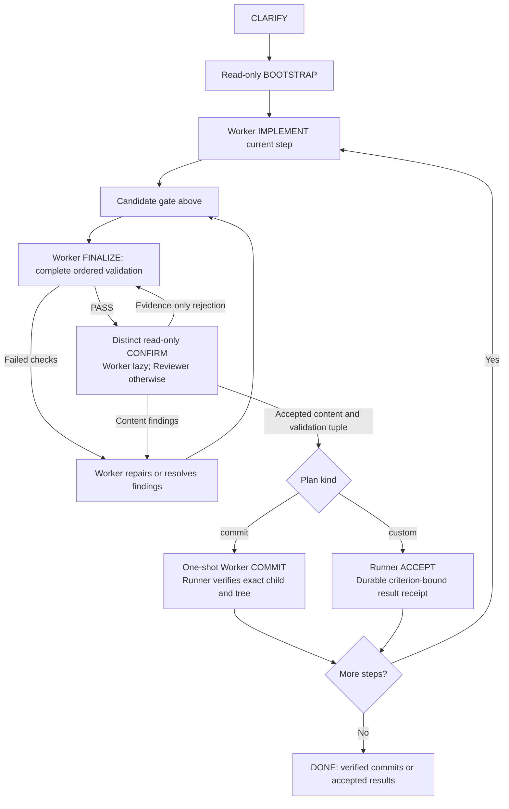
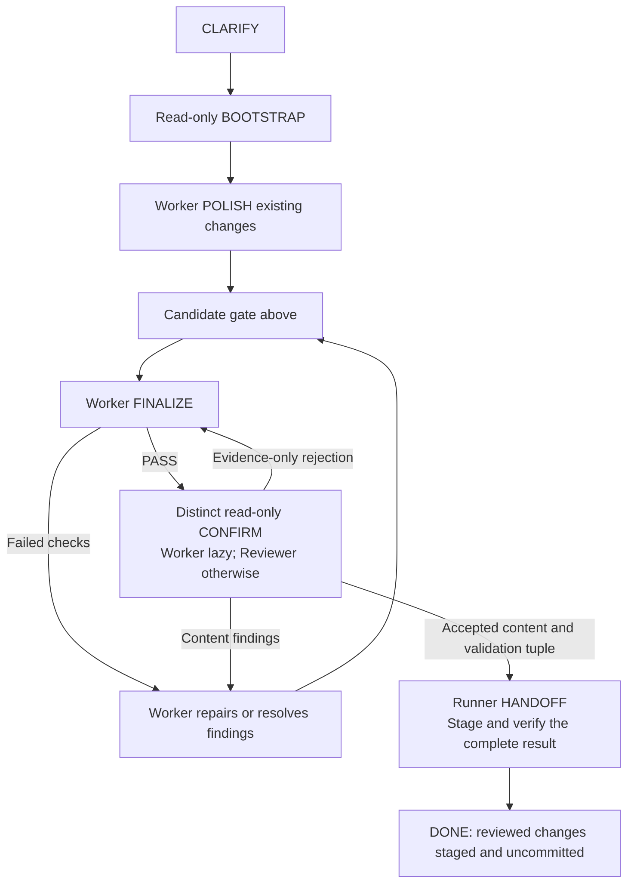
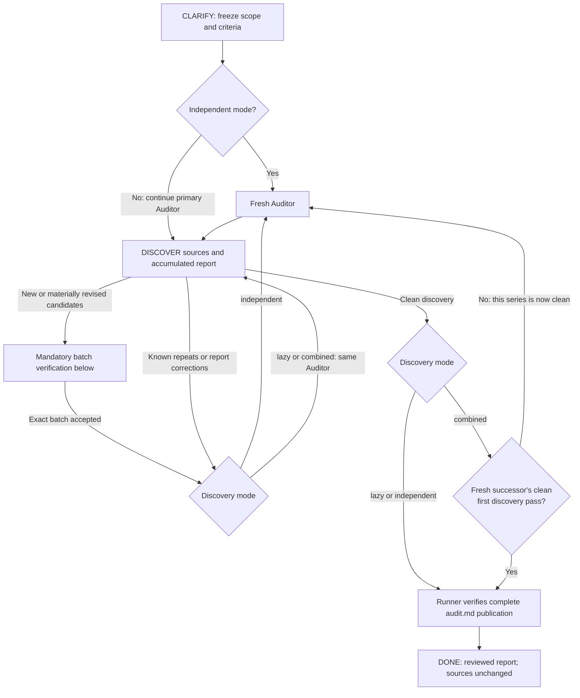
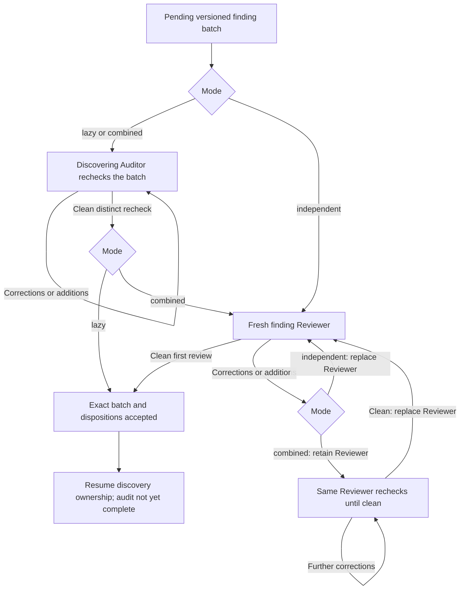
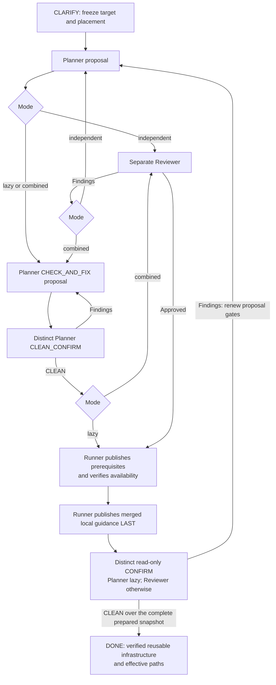

# Agent Runner

It works as a level 4 software factory on
[Dan Shapiro's five levels of AI-assisted coding](https://simonwillison.net/2026/Jan/28/the-five-levels/):
you own the spec and the plan, but you don't have to write them by hand. Shape
them in a conversation with your coding agent, and the agent drives Agent Runner
over MCP: it starts the pipeline, waits for it, and brings product decisions
back to you. Inside the pipeline, agents implement and review each other's work,
and you review the result. It is not a level 5 "dark factory": a human still
reads what ships.

Agent Runner is a local CLI and STDIO MCP server for durable agent pipelines.

## Quickstart

After installing the [requirements](#requirements), link the local CLI:

```bash
npm ci
npm link
```

Register the STDIO MCP server with the client you use, then restart it:

```bash
codex mcp add agent_runner -- agent-run mcp
claude mcp add --transport stdio --scope user agent_runner -- agent-run mcp
```

```text
Using Agent Runner, create a commit-by-commit plan for adding a new adapter
(with a modular, idiomatic design that reuses existing modules). If the plan is
satisfactory, use Agent Runner to execute it.
```

| Mode          | Quality | Speed | Token consumption | Meaning                                                         |
| ------------- | ------- | ----- | ----------------- | --------------------------------------------------------------- |
| `lazy`        | ★★★☆☆   | ★★★★★ | ★★☆☆☆             | Lower-consumption self-review without an independent Reviewer.  |
| `independent` | ★★★★☆   | ★★★☆☆ | ★★★★☆             | Recommended default with genuinely independent semantic review. |
| `combined`    | ★★★★★   | ★★☆☆☆ | ★★★★★             | Primary self-convergence followed by the full independent gate. |

See [Installation](#installation) for update behavior and verification, and
[MCP](#mcp) for long-wait configuration and the complete tool workflow.

The npm-workspaces monorepo orchestrates Codex CLI and Claude Code while keeping
persistence, Git safety, and backend execution in one small runner.

All registered pipelines are runnable through the CLI and the local STDIO MCP
control plane.

Start with the [`docs` map and change gate](docs/README.md). Architecture is
documented in [`docs/ARCHITECTURE.md`](docs/ARCHITECTURE.md), and each pipeline
owns its specification under its workspace.

Read the [operator guide](docs/OPERATOR_GUIDE.md) for the complete CLI/MCP
supervision procedure, pause recovery, validation boundaries, and safe
project-local operating guidance.

## Core Guarantees

Plan execution pauses for plan revision when initial implementation leaves the
selected step's content unchanged. Runner-observed step-start evidence survives
partial work and resume; missing legacy evidence must be reconstructed from the
validated journal before new writable work. Unchanged corrective turns remain
valid after initial acceptance. See the [execution specification](pipelines/plan-execution/docs/SPEC.md).

- Pipelines own their roles, inputs, prompts, state machines, and output policy.
- The root runner owns lifecycle, persistence, backend execution, and Git safety.
- Every pipeline starts with a bounded, read-only `CLARIFY` phase.
- After clarification closes, a blocking material product decision pauses the
  pipeline through `PRODUCT_DECISION_REQUIRED`.
- Every built-in pipeline supports `independent`, `lazy`, and `combined` modes.
  `independent` is the default and recommended choice because it provides
  genuinely independent semantic review, at the cost of more provider context
  and tokens. `lazy` is an explicit lower-consumption choice that uses only the
  primary agent and does not provide independent review; it is never selected
  automatically. `combined` adds primary
  convergence followed by independent review.
- Codex and Claude can be selected independently for each pipeline role.
- Read-only agent turns include repository-mutation verification.
- Codex repository writable turns expose an existing real project `.agents` directory,
  while role prompts permit changing it only for an explicit task requirement
  and, during plan execution, an explicit current plan step. A symlinked
  `.agents`, `.git`, and `.codex` stay protected.
- The adapter foundation also supports declared directory reads and output-only
  writes in Codex 0.164.0 or newer and Claude Code 2.1.233 or newer on Linux,
  without Git or commit readiness. Claude writes through sandboxed Bash to
  existing declared output roots. Explicit custom execution uses these directory permissions; see the [provider contract](docs/product/PROVIDER_MODEL.md).
- The runner lifecycle foundation selects workspace and lease requirements from
  pipeline descriptors before Git inspection. Directory bindings, protected
  inputs and output permissions survive recovery; repository-contained directory
  work shares the enclosing worktree lease. Explicit custom authoring uses that
  directory lifecycle, as does explicitly selected custom execution; commit authoring, commit execution and polishing require Git. Missing Git never selects another completion contract.
- `plan-authoring` confines writes to its resolved `clarifications.md` and
  `plan.md` artifact paths, including task directories inside the target
  repository.
- In `plan-execution`, the Worker receives one-shot authorization for the exact
  planned local commit after candidate convergence, successful finalization,
  and a distinct read-only terminal confirmation.
- `polishing` finalizes and applies the selected review gate to existing
  workspace changes while preserving `HEAD` for a later commit workflow.
- Commit creation uses the repository's configured Git identity and the exact
  subject-only Conventional Commit message; validation includes
  `Co-authored-by` in its trailer denylist.
- Retry exhaustion and unsafe states pause with unresolved work preserved.
- Persistent state lives outside both the target repository and task directory.
- Remote repositories and their configuration remain read-only in V1.

## Requirements

- Node.js 24 LTS: `>=24 <25`
- Git
- Codex CLI 0.147.0 or newer stable and/or Claude Code 2.1.233 or newer stable,
  depending on the selected role backends
- Linux with usable user and PID namespaces and system-installed `bubblewrap`
  for owned execution and trusted validation, plus `socat` for the Claude backend

Claude does not require host `CAP_SYS_ADMIN`. It prefers its full native
sandbox and may automatically use a restricted-host composition only when an
exact probe proves that nested user namespaces are denied and that a private
Runner command launcher validates and strengthens Claude's effective
bubblewrap invocation. The Claude CLI and its provider transport remain on the
host, while each model-issued command crosses one bubblewrap boundary with
private user, PID, mount, network, `/proc`, `/tmp`, and `/run` views. There is
no configuration override. If either composition cannot prove a requested
read-only, workspace-write, or local-commit mode, the run fails early with a
bounded unsupported-backend diagnosis through both CLI and MCP.

The project uses native ES modules. External runtime dependencies comprise the
official Node MCP server SDK and its schema library.

## Installation

From the Agent Runner repository root, install the pinned dependencies and link
the executable into the active Node.js installation:

```bash
npm ci
npm link
command -v agent-run
agent-run --help
```

`npm link` exposes `agent-run` as a symbolic link to this checkout. Source-only
updates are therefore available to every newly started CLI or MCP process.
Rerun `npm ci` when dependencies change, and rerun `npm link` only after the
link or active Node.js installation changes.

Register the linked executable as a user-level STDIO MCP server in each agent
client you use:

```bash
# Codex
codex mcp add agent_runner -- agent-run mcp
codex mcp get agent_runner

# Claude Code
claude mcp add --transport stdio --scope user agent_runner -- agent-run mcp
claude mcp get agent_runner
```

Restart the agent client after adding the server or updating Agent Runner so it
starts a fresh MCP process. Existing durable runs remain in runner state and can
be resumed after restart. Configure the longer Codex tool timeout shown in
[MCP](#mcp) before waiting on long runs.

For repository development without a linked executable, run
`node bin/agent-run.js` directly or use the absolute executable path in the MCP
configuration.

### Local application artifacts

From a checkout prepared with `npm ci`, assemble and inspect a local candidate:

```bash
npm run release:assemble -- --output dist/candidate
```

The output directory must be absent. Assembly creates `package/`, an exact-file
`release-manifest.json`, and a locally packed tarball. It materializes private
workspaces and the locked production dependency closure as real directories,
retaining native ESM, public indexes, the executable CLI and the complete operator
guide. npm packs offline with lifecycle scripts disabled and isolated empty
configuration. The assembler reads the actual archive and compares every regular
file, byte hash and executable mode to the manifest; extra files and links fail.
Node.js `>=24 <25`, Git and the documented native tools remain prerequisites.

Explicit package file allowlists exclude local settings, credentials, durable
state, task artifacts, Git/provider metadata, tests and development tooling.
Incomplete outputs remain in their fresh directory for inspection; choose a new
output directory for another assembly. Existing directories are never overwritten
or removed. The checkout retains its npm workspace links and normal `npm ci` /
`npm link` development workflow.

`@your-scope/agent-runner` is neutral candidate metadata for local validation.
The source and assembled package retain `private: true` and `UNLICENSED`.
Publication remains blocked pending separately approved owner/identity, scope,
license, repository links and publisher configuration. Successful local packing
does not establish public availability or additional execution-platform support.
Clean external installation acceptance is a separate package-install gate;
assembly never changes global/native links or activates another controller.

### Approved npm releases

The [release procedure](docs/RELEASING.md) owns administrative setup and recovery.
The checked-in workflow is disabled by explicit approval policy and private
package metadata. After separate owner/scope/license and trusted-publisher
approval, only an explicitly published stable GitHub Release at the matching
version tag in `main` can publish. Protected environment approval follows
ordinary checks, separate package-install acceptance and complete slow coverage.
OIDC/provenance publication consumes the exact tested tarball; public download
and isolated installation verify it afterward. Retries verify matching existing
bytes without overwriting versions or moving tags; partial publication stays
failed and visible. Release notes link the exact npm version and state the
configuration/run-state compatibility and restart requirements.

The root update capability supports on-demand compatibility reporting. It shares
the bundled official approval policy with release tooling and currently blocks
registry actions because official identity remains unapproved. Reports distinguish
installed and running versions, stable availability, compatibility blockers and
restart needs. A current installation is a successful no-op; prereleases require
an exact explicit version. Linked checkouts stay development-managed. Checking
changes no installation or saved run, and automatic behavior stays disabled.
CLI/MCP use this same capability; see the [operator contract](docs/product/OPERATOR_MODEL.md).

The same capability can prepare an exact candidate with a caller-supplied
operation UUID. Approved registry metadata and SHA-512 integrity bind a fresh
private prefix; complete archive, payload, compatibility and isolated CLI/MCP
smoke checks precede its validated receipt. Durable intents retain ownership
and reconcile interrupted installation before retry. Failed attempts preserve
the current payload, settings and runs. Preparation activates nothing, changes
no global link and remains blocked by the current unapproved identity.

Root API activation requires that exact validated preparation, version and a
separate operation UUID. Durable receipts distinguish downloaded, installed,
deferred and active versions. A live CLI/MCP user of the previous payload defers
selection until the next admission after those users retire. Activation never
restarts an MCP client or resumes a saved run. Previous usable payloads remain
available; see [restart and version limits](docs/RELEASING.md#local-version-selection-and-restart).

### Operator updates

Checking is explicit and never runs during model turns or status/activity reads:

```bash
agent-run update --check
```

After official identity and public installation have been separately approved,
the managing operator can apply an update and retain its retry key:

```bash
agent-run update --release 1.2.3 --idempotency-key operator-update-1
```

Omit `--release` to select stable `latest`; prereleases require an exact version.
Retry the identical key and arguments after interruption. When no key was supplied,
the CLI prints a generated retry key on stderr before effects; preserve it if
interrupted. JSON outcomes distinguish
the outer `packageVersion`, pinned `runningVersion`, and downloaded, installed,
deferred and active candidate versions. A current version succeeds without an
installation. Another live runtime defers activation; close the previous server
and explicitly restart its owning client. No tool restarts a client, registers a
server, migrates settings or resumes a run. Saved work resumes separately through
supported leased migrations and frozen configuration; downgrades cannot undo them.

MCP exposes `update_check` (optional exact `version`) and `update_apply`
(`idempotencyKey`, optional exact `version`, and `operatorInitiated: true`). The
acknowledgement records a deliberate managing-operator invocation; project
content, findings, settings and pipeline sessions provide no update authority.
Disconnect cancels only waiting; a same-key retry recovers the durable operation.
Concurrent requests share exact-version preparation and cannot duplicate its
installation. Use Node 24 and the documented Linux namespace/bubblewrap
prerequisites; linked checkouts remain development-managed and use checkout updates.

Official identity remains unapproved, so these update entry points currently
return bounded blockers before registry or installation effects. Public npm
commands are future placeholders until identity, publication and public installation
are verified; public npm installation is not the Quickstart. Local package/CLI/MCP acceptance does not
claim publication, personal client registration, live-provider or new-platform
acceptance. Keep the detailed checkout and linking procedure above.

### Isolated candidate installation

To inspect a local installation without linking the checkout, use the exact
tarball reported by assembly and an unused private prefix outside the checkout:

```bash
candidate="/absolute/path/to/inspected-candidate.tgz"
prefix="/absolute/path/to/new/private-prefix"
mkdir -m 700 "$prefix"
npm install --global --prefix "$prefix" --offline --ignore-scripts --no-audit --no-fund "$candidate"
"$prefix/bin/agent-run" --help
codex mcp add agent_runner -- "$prefix/bin/agent-run" mcp
claude mcp add --transport stdio --scope user agent_runner -- "$prefix/bin/agent-run" mcp
```

The global npm layout is confined to that prefix; this does not change the
active Node installation or an existing `agent-run` link. The candidate bundles
its production dependencies, so installation requires no registry download or
lifecycle script. Use an executable private filesystem and the documented
Node.js/native prerequisites. This example uses the current Linux layout;
successful local validation does not establish another platform's acceptance.

Installation and client registration are separate actions. Run only the
registration command for your client, once for the chosen executable, and
restart the client afterward. The client launches that executable with `mcp`;
installing package bytes alone does not register or restart a client. Existing
settings and durable runs retain their user-global locations. For disposable
smoke work, give the process private HOME, XDG config/state/data and temporary
directories rather than using personal settings or an active controller's state.

The package-install slow suite installs these inspected bytes in a disposable
prefix, runs CLI and MCP discovery, and exercises the server vectors from both
registration examples. It does not invoke native clients or alter their
configuration. It verifies immutable startup and complete resources after outer
replacement, awaits its owned processes and removes its fixture storage.
Failed or unrun installation coverage remains outstanding. Packing, local
installation and protocol smoke do not authorize publication, update another
controller, or establish live-provider/native-platform acceptance. The checkout
and `npm link` instructions above remain the development workflow; npm registry
installation is not a Quickstart while public identity/publication is unapproved.

### Pinned application payloads

The executable enters a standard-library bootstrap before importing the
application. An assembled installation is verified against its complete release
manifest and materialized into a user-owned read-only payload. Application code,
bundled dependencies, delayed imports and runtime resources then resolve from
that payload, so replacing the outer package cannot change a running process.

Payload storage uses `$XDG_DATA_HOME/agent-runner/runtime` on Linux, falling back
to `$HOME/.local/share/agent-runner/runtime`; macOS uses
`~/Library/Application Support/agent-runner/runtime`, and Windows uses
`%LOCALAPPDATA%\agent-runner\runtime`. These location mappings do not extend
execution-platform acceptance. Settings, credentials and durable run state stay
outside payloads. The legacy configuration fallback retains the original outer
installation path; frozen run configuration is never resolved again.

Preparation publishes only a complete verified tree through an exclusive
reference, preserving any destination that appears concurrently. Processes use
the verified physical tree path. Partial preparations remain separate and are
never selected or reused. Existing damaged payloads fail closed instead of being
overwritten or repaired. MCP detached
continuations verify the same payload and exact Node executable identity before
launch, then verify the binding again before application imports. They retain
the existing compatibility and dispatch-admission gates.

Git checkouts, including `npm link` development, remain development-managed and
create no payload storage. Application startup through the executable owns
pinning; direct source API imports do not bootstrap an installed process.
Payload preparation performs no package installation, controller activation,
run migration or implicit resume. Normal startup reads an already-published
selection before application imports; detached continuations retain their exact
original payload. Linked development bypasses installed-runtime selection.

Pinned CLI/MCP processes register their exact payload and process identity in
user state. New runs, resumes and detached commands pass the same serialized
admission boundary. Activation is deferred while positively associated users
of another payload remain alive; an unverifiable owner remains blocking.
Unrelated host processes are neither enumerated nor signaled. Explicit runtime
activation selects a verified payload or durably queues it for the next safe
admission. A racing obsolete start cannot bypass that selection. Previous
payloads and saved progress remain intact. Resume remains an explicit operation
using supported leased migrations and the run's original frozen configuration;
unknown forward versions fail without modifying progress. The root capability
adds no public update command, automatic update, migration or resume authority.

## Pipelines

| Pipeline         | Purpose                                                                                         | Specification                                                                    |
| ---------------- | ----------------------------------------------------------------------------------------------- | -------------------------------------------------------------------------------- |
| `plan-authoring` | Analyze a task, review a draft, and atomically write `plan.md`                                  | [`pipelines/plan-authoring/docs/SPEC.md`](pipelines/plan-authoring/docs/SPEC.md) |
| `plan-execution` | Execute reviewed commit steps or criterion-driven custom results                                | [`pipelines/plan-execution/docs/SPEC.md`](pipelines/plan-execution/docs/SPEC.md) |
| `audit`          | Inspect an agreed Git or ordinary workspace read-only and publish reviewed `audit.md`           | [`pipelines/audit/docs/SPEC.md`](pipelines/audit/docs/SPEC.md)                   |
| `polishing`      | Polish, finalize, review, and stage existing dirty-worktree changes for a later commit workflow | [`pipelines/polishing/docs/SPEC.md`](pipelines/polishing/docs/SPEC.md)           |
| `init`           | Prepare reviewed integrated or external infrastructure without committing                       | [`pipelines/init/docs/SPEC.md`](pipelines/init/docs/SPEC.md)                     |

Plan authoring and execution share the deterministic
[`@agent-runner/commit-plan`](packages/commit-plan/README.md) contract. The
authoring pipeline produces that artifact; the execution pipeline consumes it.
Polishing is independently owned and operates directly on the current workspace
change set.

The separate [`@agent-runner/custom-plan`](packages/custom-plan/README.md)
package defines criterion-driven `Step N` plans, including analysis-only results.
Explicit custom authoring and sequential execution are available through CLI/MCP/configuration. Custom completion produces accepted result receipts, including analysis without a file diff; it never stages or commits.

The diagrams below show the normal gates; the linked specifications own exact
recovery and finding-resolution rules. `independent` remains the default and
recommended mode. `lazy` uses only the primary role, with no independent review;
`combined` requires primary convergence before its independent gate.

Every pipeline starts with read-only clarification. Material questions stay in
`CLARIFY`; an empty artifact is valid. Runner freezes the accepted transcript
before work. Ordinary questions then close; only an otherwise blocking unresolved
material product requirement can enter `PRODUCT_DECISION_REQUIRED`.

These pause boundaries apply throughout the diagrams:



Resume preserves mode, counters and consumed effects; it does not renew budgets
or replay a possibly completed commit or publication. Primary clean confirmation
requires structured `CLEAN`; all read-only gates require no mutation and the
unchanged inspected fingerprint.
Logical roles can continue a native session or reconstruct from durable state;
reconstruction grants neither new authority nor independent review. A deliberately
supplied source is forked once for the lazy primary, or separately by relevant
primary/review checkpoints in independent and combined modes. Fresh reviewers
receive frozen inputs and bounded structured evidence, never another role's chat.

### Plan authoring

[Authoring](pipelines/plan-authoring/docs/SPEC.md) returns a reviewed `plan.md`.
Commit plans carry exact validated Conventional Commit subjects; explicit custom
plans carry agreed criteria, observable results and frozen input/output
declarations. Sources stay read-only; declarations grant no authoring writes or
retrieval. All agent turns are repository-read-only and return structured drafts.
Only Runner writes the artifact after deterministic validation.



Planner corrections continue the planning checkpoint; independent review has its
own checkpoint. Combined Reviewer revisions restart Planner convergence. Only
bounded independent finding resolution can use a fresh Arbiter; self-confirmation
and structural exhaustion pause without arbitration. Authoring never implements
the plan or creates a commit.

### Candidate gates for execution and polishing

Execution and polishing establish validation read-only in `BOOTSTRAP`: Worker and
Reviewer independently in independent/combined modes, Worker alone in lazy mode.
Their candidate gate precedes finalization:



Combined primary confirmation and independent approval bind the same candidate.
Self-findings return directly to fixing, without Reviewer or Arbiter. Independent
findings retain bounded fix, withdrawal, dispute, fresh arbitration and exact
recorded override routes. Resolved findings re-enter the selected candidate gate
even when content is unchanged. Combined bootstrap disagreements and primary exhaustion
pause without arbitration. Every content repair invalidates dependent candidate,
finalization and terminal-confirmation evidence and restarts the selected gate.

### Plan execution

[Execution](pipelines/plan-execution/docs/SPEC.md) consumes the frozen plan in
order. Commit execution requires an initial content change and completes each
step with one verified local commit using its exact heading subject, without a
body or footer. Explicit custom execution can accept analysis without a diff:
agreed criteria and inspected outputs bind a durable accepted-result checkpoint,
with no staging or Git authority even inside a repository.



Independent/combined Worker and Reviewer work checkpoints are fresh for each
step and continue within it; lazy retains one logical Worker and its source-fork
lineage across the run. Finalization may format the accepted candidate; terminal
confirmation covers that resulting fingerprint and the complete validation tuple.
An unchanged resolution can reuse still-current finalization only after the
required candidate gates and fresh fingerprint checks. Consumed effects settle
by verification before another step; a conflicting clarification requires a
revised plan and new run, never rewritten completed history.

### Polishing

[Polishing](pipelines/polishing/docs/SPEC.md) starts with an existing nonempty
change set. It uses the same candidate gates, then finalizes and confirms the
whole result. Worker and Reviewer checkpoints remain separate; lazy continues
the logical Worker. No agent turn can change the index.



Finalization remains staging-independent. Its resulting fingerprint and evidence
require terminal confirmation, including formatter output. Unchanged resolutions
can reuse only current finalization after reconvergence; content repairs renew
the gates. Runner alone stages at `HANDOFF`; `HEAD` stays unchanged and no commit
is created.

### Audit: discovery and finding verification

[Audit](pipelines/audit/docs/SPEC.md) reads agreed Git or ordinary-directory
sources and accumulates a structured report. All Auditor and finding Reviewer
turns are read-only. Corrections change the report, never the audited project.
The same mode names govern audit-specific discovery sessions:



A finding-producing `COMPLETE` pass can finish one coherent, usable batch while
later passes continue scope inspection. Use concise supported evidence and
targeted reads; candidates contain only new findings or material revisions,
without repeating the accumulated report. Existing result and collection limits
apply without a finding quota or additional batch cap. Every material batch
blocks further discovery until verified.
`INCOMPLETE` work supplies no adopted candidates or report changes.

Clean discovery requires complete agreed-scope inspection with no candidates or
substantive report corrections; the accumulated report may contain findings.
Independent uses a fresh Auditor each pass and needs no redundant
unchanged-response turn after clean discovery. Combined always replaces the
initial Auditor after its series becomes clean. A fresh successor that finds
anything finishes its own lazy series before replacement; its later clean pass
cannot complete the audit. For example:

```text
Auditor 1: findings -> verification -> further discovery -> clean
Auditor 2 (fresh): findings -> verification -> same-Auditor discovery -> clean
Auditor 3 (fresh): clean first discovery pass -> complete publication
```

Every new/material finding batch suspends discovery for this separate gate:



Rechecks confirm, correct, reject, merge or retain an unverified hypothesis;
changed versions and review additions need verification themselves. Rejected
decisions remain durable and never retroactively make discovery clean. A clean
batch review accepts only that batch, not discovery or the audit. Combined
requires same-Auditor convergence followed by a fresh Reviewer's clean first
pass; a correcting Reviewer finishes its own series before replacement.

Discovery and finding rechecks have separate run-wide budgets, each capped at
20, including across sessions and reconstruction. Invalid or interrupted turns
cannot establish cleanliness or renew either budget. Exhaustion pauses resumably
with the draft and pending verification preserved; reconstruction creates no
fresh-first-pass opportunity. Runner alone publishes `audit.md`, including an
in-progress draft after accepted updates. Only current versions with exact
accepted receipts appear confirmed; pending candidates and
hypotheses stay explicitly unverified. Completion requires the selected discovery
gate, no pending verification, unchanged bindings and verified complete publication.
Zero or Critical findings can accompany success. Findings grant no fixes, Git
effects or automatic issue creation.

### Init

[Init](pipelines/init/docs/SPEC.md) freezes target-bound integrated or external
placement independently of review mode. Planner proposals and every review or
confirmation turn are read-only; Runner publishes the reviewed resources.
Proposal acceptance alone does not mean infrastructure is available.

Rejected semantic results expose a finite constraint, original code and fixed
corrective guidance. Same-checkpoint resume/reconstruction receives matching
feedback; rejected resources remain unpublished and the last valid proposal is
preserved. Acceptance or a product decision clears feedback without renewing
budgets. See [init semantic rejection](pipelines/init/docs/SPEC.md#semantic-result-rejection).



Primary corrections continue their logical owner; Reviewer remains separate in
independent/combined modes. Revisions invalidate dependent approvals and preserve
bounded accounting. Integrated placement preserves existing skills and unrelated
settings; external placement leaves the target and Git controls unchanged.
Completion verifies prerequisites, guidance and the complete prepared snapshot;
it does not claim the prepared finalization procedure was executed. Setup never
stages, commits or starts another pipeline, and interrupted publication reconciles
its exact intent and receipts before continuing.

## Configuration

Trusted provider-profile implementations and runner defaults belong to the
user-global configuration, outside the installation:

| Platform | Configuration file                                                                                                            |
| -------- | ----------------------------------------------------------------------------------------------------------------------------- |
| Linux    | `$XDG_CONFIG_HOME/agent-runner/config.json`, or `$HOME/.config/agent-runner/config.json` when XDG is unset, empty or relative |
| macOS    | `$HOME/Library/Application Support/agent-runner/config.json`                                                                  |
| Windows  | `%APPDATA%\agent-runner\config.json` (APPDATA must include its drive or UNC share)                                            |

Create the parent directory and copy the tracked
[example](.agent-runner.example.json) there for new settings. These location
conventions do not expand the supported execution platforms. Settings, native
credentials and durable state remain separate from application payloads.
The global layer is also called runner-root or runner-local configuration below;
it retains the same schema and authority.

For an existing installation or linked checkout, explicitly migrate its legacy
file before ordinary configuration resolution:

```bash
agent-run config migrate --from /path/to/legacy/.agent-runner.json
```

Migration validates the source and atomically copies its exact bytes only to an
absent user file, using private directories and a mode-0600 file. Identical
bytes are a no-op; conflicts, including formatting differences, never merge,
overwrite or delete either file. The source stays in place. Private temporary
files left by interruption are never adopted or removed by a later invocation.
If interruption leaves the destination linked to its temporary file, loading
and migration fail closed while preserving both names and the source. A
completed publication can be retried as an identical no-op.

The user file takes precedence over the installation-local `.agent-runner.json`;
the latter remains a compatibility fallback only when the user file is absent.
An invalid, unreadable or unsafe user file fails instead of falling back. Global
files must be bounded UTF-8 regular files without symbolic/hard links or linked
ancestors. Ordinary reads create nothing. User settings survive installation
replacement and linked development. Migration is an explicit managing-operator
action for future work; never use it to alter a running workflow's configuration.
Existing runs continue with their frozen snapshots and never reload these files.

When present, the file requires `"schemaVersion": 1`; unknown versions, fields,
pipelines, roles, profiles, and settings are errors. `profiles` defines trusted
aliases pinned to one backend: Codex aliases map to native profile names and
Claude aliases map to absolute isolated configuration directories. Profile
entries contain provider selectors and execution preferences. A selected alias
supplies its backend; a conflicting explicit backend is invalid.

`issueReporting` is a runner-local boolean and defaults to `true`. It controls
deliberate capture through the MCP-only unexpected-issue tool described below.
Set it to `false` and restart the MCP server to remove the tool, its schema,
and all related server instructions from discovery. This discovery switch is
restart-scoped and does not select issue storage. Backlog management through
`issues_list`, `issues_read`, `issues_update`, and `agent-run issues` stays
available when capture is disabled. Its scope is the runner-local configuration.

`clientAttribution` is a runner-root-only exact `{ "name", "title" }` object
for provider-visible client identity. It defaults to
`{ "name": "agent_runner", "title": "Agent Runner" }`. Both strings must be
non-empty, trimmed, at most 256 characters, and free of unsafe control or
bidirectional formatting characters. Project configuration, CLI, MCP,
pipelines, prompts, and repository content cannot override it. Custom identity
requires support from every active role provider; Codex supports it and Claude
does not. New runs persist its normalized value and fingerprint, resume ignores
later root-configuration changes, and legacy runs use the generic default.
Public prompts, status, activity, and diagnostics do not expose it.

A target repository may optionally provide an ignored, untracked
`LOCAL_ARTIFACTS/agent-runner.json`, or a new run may select another confined
ignored path with `--project-config`. An explicitly selected external file may
instead declare an exact target-bound infrastructure root. A project file may
select aliases already trusted by the runner, set backend/model/context defaults, override pipeline
roles and limits, and select a normalized repository-relative `artifactRoot`.
It may also define exact `trustedCommands` vectors under the same contract as
the runner catalog; profile implementations remain runner-owned. Agent Runner
expects an existing confined regular file; integrated Git files must also be
ignored and untracked.

For an existing external setup, select its configuration explicitly with
`--project-config /workspace/infrastructure/agent-runner.json` (MCP:
`projectConfigurationPath`). Include this project-only binding in that file:

```json
{
  "schemaVersion": 1,
  "infrastructure": {
    "schemaVersion": 1,
    "placement": "external",
    "projectPath": "/workspace/project",
    "rootPath": "/workspace/infrastructure"
  },
  "artifactRoot": "artifacts"
}
```

Both binding paths must be canonical absolute paths to existing real directories.
The selected file must be below its infrastructure root, which must be disjoint
from the target. Relative infrastructure resources resolve from that root;
here the artifact path is `/workspace/infrastructure/artifacts`. The configuration
loader exposes this resolved path. Local operator guidance uses
`/workspace/infrastructure/artifacts/agent-runner/rules.md`; individual workflow
artifact publication contracts still govern where they write. External selection creates
no target files, ignore rules, pointer files or global registration. It never
discovers sibling setups automatically or merges them with integrated settings.
An explicit integrated binding uses `placement: "integrated"` and the canonical
project path for both paths; existing integrated files need no binding.
Git workflows resolve a supplied project subdirectory to the canonical worktree
target. Relative external configuration selectors resolve from the supplied
directory before that rebasing, including in polishing. Custom directory
workflows keep their supplied directory scope.

For a run that uses this file, Agent Runner persists its canonical path,
content hash, file identity, and real-directory ancestry before agent work.
External records also pin the infrastructure root and target directory identity.
The runner checks that record around provider turns and before recovery,
trusted validation, commit, handoff, and stop reconciliation. Removal, content
drift, replacement, hard links, symbolic links, or redirected ancestors pause
the run as `project_configuration_changed`; restoring similar content does not
authorize that run to continue. Legacy runs with no protection record remain
compatible and do not infer one from current files.

For execution preferences, CLI/MCP role values win over CLI/MCP run-wide
values, then project-role and project-wide values, runner-role and runner-wide
values, and finally built-in `current`. Explicit CLI/MCP pipeline-setting
overrides win over project pipeline settings, which win over runner settings
and descriptor defaults. `resume` uses the persisted roles, settings, and
artifact root and never reloads the mode.

Every role accepts string `profile`, `model`, `contextSize`, and `effort`
selections.
Root and safe ignored project configuration accept `defaultEffort`, with role
`effort` values taking precedence within each layer. Portable effort values are
`current`, `low`, `medium`, `high`, `xhigh`, and `max`; `current` retains the provider
default. Use `--effort` or MCP `run_start.effort` for a run-wide override, and
`--<role>-effort` or `roleOverrides.<role>.effort` for a role override. Only
active roles persist the resolved selection, and resume reuses it without
reloading configuration.
A selected profile supplies its backend; `defaultBackend` provides the fallback.
Explicit decimal context sizes are validated by the chosen adapter and map to
Codex's context window or Claude's auto-compaction token window.

The supported backend IDs and their trusted-profile and execution rules come
from one frozen, source-controlled provider registry. The same registry builds
runner adapters, validates source-session selections, and supplies MCP backend
enums. It is an explicit extension seam for repository development, not a
runtime plugin or configuration surface.

| Backend | `model: "current"`                                                        | `profile: "current"`                                                   |
| ------- | ------------------------------------------------------------------------- | ---------------------------------------------------------------------- |
| Codex   | Omit the model override and use the effective native Codex default        | Omit `--profile` and inherit the current process/profile               |
| Claude  | Omit `--model` and use the effective Claude configuration/account default | Omit `CLAUDE_CONFIG_DIR` and inherit the current process configuration |

The `current` selection delegates changing native model IDs to each backend.
The tracked [example](.agent-runner.example.json) selects Claude `opus` with
`high` effort for Planner/Worker roles, Codex `gpt-6.1-sol` with `xhigh`
effort for every Reviewer and Arbiter, and Claude `fable` with `max` effort
for Auditor.
It also shows `claude-primary` and `claude-secondary` profile aliases alongside
the native defaults.
`artifactRoot` defaults to `LOCAL_ARTIFACTS`.

Pipeline settings use these defaults:

| Pipeline         | Setting                          |       Default |
| ---------------- | -------------------------------- | ------------: |
| `plan-authoring` | `planKind`                       |      `commit` |
| `plan-authoring` | `criteriaPath`                   |        `null` |
| `plan-authoring` | `sourceReferences`               |          `[]` |
| `plan-authoring` | `outputPaths`                    |          `[]` |
| `plan-authoring` | `mode`                           | `independent` |
| `plan-authoring` | `maxRevisionRounds`              |            20 |
| `plan-authoring` | `preferredCommitLineLimit`       |           900 |
| `plan-authoring` | `stagnationWindowRounds`         |             3 |
| `plan-execution` | `planKind`                       |      `commit` |
| `plan-execution` | `mode`                           | `independent` |
| `plan-execution` | `automaticCommitSplitting`       |        `true` |
| `plan-execution` | `preferredCommitLineLimit`       |           900 |
| `plan-execution` | `commitSizeAssessmentMultiplier` |             3 |
| `plan-execution` | `maxFixRoundsPerStep`            |            20 |
| `plan-execution` | `finalization`                   |        `auto` |
| `plan-execution` | `maxDisputesPerFinding`          |             5 |
| `plan-execution` | `maxSameFindingRounds`           |             5 |
| `plan-execution` | `stagnationWindowRounds`         |             3 |
| `plan-execution` | `trustedChecks`                  |          `[]` |
| `polishing`      | `mode`                           | `independent` |
| `polishing`      | `maxFixRounds`                   |            20 |
| `polishing`      | `finalization`                   |        `auto` |
| `polishing`      | `maxDisputesPerFinding`          |             5 |
| `polishing`      | `maxSameFindingRounds`           |             5 |
| `polishing`      | `stagnationWindowRounds`         |             3 |
| `init`           | `mode`                           | `independent` |
| `init`           | `placement`                      |        `null` |
| `init`           | `maxRevisionRounds`              |          `20` |
| `audit`          | `mode`                           | `independent` |
| `audit`          | `sourceScope`                    |   `directory` |
| `audit`          | `excludePaths`                   |          `[]` |
| `audit`          | `maxDiscoveryPasses`             |          `20` |
| `audit`          | `maxFindingRecheckPasses`        |          `20` |
| `polishing`      | `trustedChecks`                  |          `[]` |

`mode` accepts `independent`, `lazy`, and `combined` in every pipeline. A missing value
resolves to `independent`. The tracked [example](.agent-runner.example.json) selects
`independent` explicitly for every pipeline. Runner and ignored project
configuration may select a descriptor-supported value, and `--mode` or MCP
`run_start.mode` has highest precedence. Configuration remains strictly validated for every
declared role, but a lazy run resolves, probes, persists, and invokes only its
Planner, Worker or Auditor. Inactive review-role configuration stays available in the
configuration files for a later independent run without being resolved or
exposed by the lazy run.

Combined authoring adds Planner check/fix and a separate clean confirmation
before the complete independent Reviewer gate. Reviewer revisions restart
primary convergence; self findings return directly to fixing. Only independent
finding resolution can use a fresh Arbiter. All agent turns remain read-only;
the runner writes the validated plan. For example:

Combined execution runs Worker check/fix and a separate read-only clean
confirmation before the complete independent candidate Reviewer gate. Both
candidate approvals bind the same content fingerprint. Finalization may format
that content; a distinct Reviewer terminal confirmation approves its resulting
fingerprint and validation evidence before one-shot commit authorization.
Content repairs restart primary convergence. Self-findings go directly to fixing;
independent findings retain disputes, withdrawals, exact recorded overrides, and
fresh on-demand arbitration. Unresolved bootstrap disagreements and primary
exhaustion pause without arbitration. Corrections remain bounded and interrupted
work is charged once; resume preserves the saved mode and consumed commits remain
verification-only.

Combined polishing uses independent bootstrap, Worker check/fix and read-only
clean confirmation, independent candidate review, finalization, and a distinct
Reviewer terminal confirmation. Content repairs restart primary convergence;
unchanged resolutions reuse only fingerprint-current finalization. Self-findings
return directly to fixing; only independent finding resolution may invoke Arbiter.
Unresolved bootstrap and exhausted primary budgets pause. Handoff remains
runner-owned staging without a commit, and resume preserves accepted evidence
and correction accounting.

```bash
agent-run run plan-authoring --project /path/to/repository --task /path/to/task --mode combined
agent-run run plan-execution --project /path/to/repository --task /path/to/task --mode combined
agent-run run polishing --project /path/to/repository --task /path/to/task --mode combined
```

The equivalent MCP `run_start` request uses the selected `pipelineId`
(`plan-authoring`, `plan-execution`, or `polishing`) and `"mode": "combined"`. Saved mode and bounded correction progress survive
resume; changing configuration does not switch an existing run.

`preferredCommitLineLimit` is a positive-integer planning target for anticipated
additions plus deletions per commit, including tests and documentation. Set it
under `pipelines.plan-authoring` in runner configuration or the safe project
overlay; project values take precedence. Planner and Plan Reviewer prefer
cohesive commits within the target, with smaller commits welcome. A larger
indivisible change remains valid when the plan explains why it cannot be split
safely. This heuristic changes neither the plan format nor execution validation.
The resolved value is persisted and reused on resume; legacy runs receive 900.
`agent-run pipelines` lists descriptor-owned setting defaults, and MCP
`pipelines_list` exposes the same defaults.

Execution separately owns `preferredCommitLineLimit: 900` and
`commitSizeAssessmentMultiplier: 3` under `pipelines.plan-execution`, with the
same project precedence and persisted resolution. Both are positive safe
integers, and their product must be a safe integer. New commit-plan runs assess reconciled work strictly above the threshold
(2,701, not 2,700, at the defaults). An atomic exception remains valid; a split
requires mode-specific plan approval and complete replacement validation. The
runner preserves all unfinished bytes externally before restoring the accepted
baseline. Worker reconstructs only the active replacement; every replacement
passes its own complete gates and exact-subject commit. Frozen plans stay
unchanged, and legacy/intermediate runs remain ineligible on resume. See the
[assessment contract](pipelines/plan-execution/docs/SPEC.md#commit-size-assessment-foundation).

`automaticCommitSplitting` is a strict boolean under `pipelines.plan-execution`
and defaults to `true`, which keeps the assessment above. Root configuration and
the safe project overlay resolve it with the same precedence; there is no CLI or
MCP run override. With `false`, a new commit-plan run never measures size,
requests an assessment or proposes replacements; it executes the predefined
plan unchanged through every ordinary validation, review, finalization,
terminal-confirmation and commit gate, and large planned commits remain valid.
Both size settings stay validated as positive integers with a safe product while
disabled. For example:

```json
{
  "pipelines": {
    "plan-execution": {
      "automaticCommitSplitting": false,
      "commitSizeAssessmentMultiplier": 4
    }
  }
}
```

Re-enabling it with that multiplier assesses strictly above 3,600 lines. The
resolved switch is frozen at creation, so changing configuration never toggles
an existing run; migrated runs keep their saved eligibility. Custom runs are
never assessed, and plan authoring's advisory target is unaffected.

Execution publishes `plan.progress.md` beside unchanged `plan.md`, retaining its
exact headings and adding size-decision footnotes, original/replacement states,
exact subjects and verified SHAs. Decimal labels are for display only. CLI status
and live activity plus MCP status/wait/activity expose the same state-derived
progress, including the artifact path and accepted effective revision. The 900-line
planning target is advisory; execution assessment starts strictly above 2,700
lines at the defaults. Editing the progress file grants no authority. Resume
regenerates missing/stale owned output; preserve its run ownership comment.
Runner refuses unrelated files, links and repository-local paths that are not
already ignored. See the
[progress contract](pipelines/plan-execution/docs/SPEC.md#derived-refinement-progress).

The stagnation window detects consecutive blocked correction rounds. In
independent mode the first full window invokes one fresh Arbiter and a second
full window pauses for the user. Lazy mode has no Arbiter and pauses at the
first full window. Harder configured limits take precedence.
For authoring, only independent Reviewer findings are eligible for arbitration;
self-review and deterministic structural exhaustion pause without it.

For plan execution and polishing, `finalization: "auto"` uses a conventional
confined repository `finalization` skill when present. The fallback derives the
complete gate from repository instructions and project-defined checks. Use
`"none"` to select that fallback deliberately, or a normalized
infrastructure-relative Markdown path to require that exact procedure, such as
`.agents/skills/finalization/RUNNER.md` beside an existing skill, or
`finalization/SKILL.md` under a selected external infrastructure root. Explicit
paths resolve from that bound root (the target itself for integrated setups);
auto discovery remains repository-local. The original skill is preserved. A
missing, escaping, linked, or invalid explicit file blocks the run. Every path retains
the dedicated fingerprint-bound finalization turn. Both workflows freeze the
effective path or fallback decision before bootstrap; automatic discovery never
switches later. New selections fingerprint file bytes, identity and real ancestry; even
an identical-byte replacement requires a new run. Selection grants only the
exact file read, never access to its parent. Custom execution keeps guidance
optional: `auto` selects none, while an explicit file supplies criterion-dependent
guidance without Git authority.

Required checks that need loopback listeners, Docker, a local database, or a
comparable host service may be delegated to the runner's trusted validation
executor. Runner-root and safe project configuration may each define
`trustedCommands` using exact inventory commands and executable/argument
vectors. Catalogs merge in root-then-project order: identical same-name
definitions deduplicate, while conflicting definitions reject configuration
even when unselected. The merged catalog accepts at most 256 aliases; each
pipeline run may select at most 32, preserving selection order in the snapshot.
Trusted commands execute in finalization's required-check inventory order.
Exact direct arguments may contain line feeds for multiline scripts; other control
characters remain invalid. This example works in either configuration source:

```json
{
  "schemaVersion": 1,
  "trustedCommandTimeoutMs": 7200000,
  "trustedCommands": {
    "service-tests": {
      "command": "npm run test:service",
      "executable": "npm",
      "arguments": ["run", "test:service"],
      "capabilities": { "sourceProjection": true }
    }
  },
  "pipelines": {
    "polishing": {
      "trustedChecks": ["service-tests"]
    }
  }
}
```

`sourceProjection: true` is the closed authority for checks that must write
build output beside source inputs. The runner reconstructs the accepted
staging-independent source in private owned storage and mounts only that copy
writable at the canonical project path. It includes frozen HEAD content plus
tracked and non-ignored untracked workspace changes, but not the index, `.git`,
ignored untracked files, project configuration, task/state paths, credentials, or other
host storage. Projected writes are discarded after verified process retirement.
Source projection does not imply scratch, cache, artifacts, or network access.

`trustedCommandTimeoutMs` is the per-command execution deadline in
milliseconds. It is a strict integer from `1` through `2147483647` and defaults
to `3600000` (60 minutes). Both configuration layers accept it; an ignored
project value overrides the runner-root value for that project. There is no CLI
or MCP override. The resolved value is fingerprinted into each new run's
trusted-validation snapshot and remains unchanged on resume, so concurrent
projects may safely use different deadlines. Legacy snapshot versions use the
same deterministic 60-minute fallback. Capability preparation remains capped
at the smaller of this value and 10 seconds.

`providerInactivityTimeoutMs` limits provider inactivity, with a conservative
`1800000` (30-minute) default. Root and project configuration accept integers
from `1` through `2147483647`; project configuration takes precedence. There is
no CLI or MCP override. Each run freezes and fingerprints the setting; resume
and legacy migration never reload it. Only validated semantic progress resets
the deadline. Owned local commands suspend it until every overlapping command
completes; keepalives, process liveness, and command output do not reset it.

Expiry records bounded recovery evidence before stopping the invocation. After
safe repository reconciliation, the same role can use its single fresh-session
reconstruction allowance without reforking the source. Native fresh fallback
uses that same durable allowance. A repeated expiry pauses as
`backend_unavailable` with `ERR_PROVIDER_INACTIVE`; an offered explicit resume
tries once without replenishing automatic recovery. Safe partial work and
correction accounting survive. CLI and MCP expose only the role, checkpoint,
attempt, and recovery status. Trusted commands, constrained commit execution,
runner-owned handoff, usage limits, operator stops, and availability backoff
retain their separate policies. See the [provider contract](docs/product/PROVIDER_MODEL.md#provider-inactivity).

`availabilityRetryMaxDelayMs` sets the frozen common availability-policy ceiling
for new runs. It accepts integers from `5000` through `2147483647` milliseconds,
defaults to `1800000` (30 minutes), and resolves project over runner configuration.
The initial delay is fixed at five seconds. Resume preserves the saved policy;
legacy runs use the default. Explicit transient availability failures in all registered
pipelines retry automatically after Git reconciliation. Delays double from five
seconds to the saved ceiling, then repeat there without a retry quota. A successful
provider response resets the episode; a normalized authentication-required response
retires it before entering the separate operator pause. Restart and partial work do
not reset it.
CLI activity and MCP status expose the role, checkpoint, reason, attempt, delay,
and deadline. A foreground CLI must be resumed after owner loss; detached MCP
work continues independently of client wait cancellation or disconnect.

Provider authentication is a distinct operator recovery. A normalized
authentication failure pauses any pipeline immediately after safe repository
reconciliation as `authentication_required`, with no availability retry or
backoff; any superseded availability episode is retired first. CLI and MCP show
the fixed `ERR_AUTHENTICATION_REQUIRED` code, the saved checkpoint, and one null
resume action without native provider details.
Reauthenticate the selected provider, then resume the same run; its roles,
session lineage, content fingerprints, and correction accounting remain
frozen. A failed source-session fork is retried only with no-effect proof;
possible-effect evidence resumes the same logical role fresh without reforking
the source. Commit readiness still verifies the existing pre-effect proof and
Git state before replacing a one-shot authorization.

An ignored project configuration may select root or project aliases through
the same pipeline setting, replacing that pipeline's root selection. The tracked
configuration example demonstrates `repository-check` in both writable pipelines.
Definitions cannot contain shell-string substitutes, environment or credential
fields, or extra host authority; profile implementations remain runner-owned.
Selection resolves to a durable fingerprinted snapshot before agent work, and
resume uses that snapshot. Later project configuration changes trigger the
protected-input guard. The runner owns the execution environment and executes
the vector directly. Before agent work, it resolves bubblewrap from fixed system
locations to a canonical absolute executable protected by system-owned file and parent
permissions. The pinned path is reverified on resume and execution. Its network
namespace has a minimal read-only system and repository view, private runtime
and temporary storage, a hidden user home, and a finite non-credential
environment. With source projection, the original repository and Git metadata
are absent and the owned copy replaces the read-only repository view. Rootless
Docker and command-owned services run inside the same
mount, network, and PID namespaces. The runner records its owned supervisor
identity and retires the complete tree, including detached descendants, before
reconciliation. Native-sandbox provider processes prefer private PID ownership
when the full nested shape is available. If nesting is unavailable on the
initial host namespace, only an explicitly declared provider may use
session/token ownership while its native sandbox remains mandatory;
ordinary processes retain private PID isolation. Nested runner tests reuse that
already-private PID namespace through the same distinct owned session when its
policy denies another PID namespace; no sandbox authority is added. A
readiness signal classifies isolation setup failures separately from executed
check failures. Workspace, Git, ref, remote, identity,
and validation-infrastructure snapshots must remain stable. Isolation or
process-tree retirement failures block or fail closed. Agent and runner results
form one complete ordered gate for the same content,
validation-infrastructure, command, and trusted-configuration fingerprints.

Trusted receipts include Runner-measured elapsed attempts through preparation,
retirement, cleanup and safety checks. Missing legacy/controller timing stays
unknown; see [validation evidence](docs/product/VALIDATION_AND_REVIEW.md#evidence-and-fingerprints).

A longer deadline changes only when an exact command times out. It cannot make
an incompatible sandbox work or improve native diagnostics. Trusted execution
deliberately retains no stdout or stderr, so a full repository check that passes
on the host can still fail closed in isolation with only a generic nonzero exit
status. Reproduce that incompatibility in an equivalent safe environment rather
than treating the timeout as a diagnostic or containment bypass.

For an offline build whose project-provided `build.js` supports `--out-dir`, a
trusted declaration can request transient output and cache storage:

```json
{
  "schemaVersion": 1,
  "trustedCommands": {
    "offline-build": {
      "command": "node build.js --out-dir /run/agent-runner/scratch/build",
      "executable": "node",
      "arguments": ["build.js", "--out-dir", "/run/agent-runner/scratch/build"],
      "capabilities": {
        "scratch": true,
        "cache": true,
        "sourceProjection": true
      }
    }
  },
  "pipelines": { "polishing": { "trustedChecks": ["offline-build"] } }
}
```

This fragment works in runner configuration or its safe project overlay. The
build tool and dependencies must be present in accepted source or supplied as
pinned artifacts; ignored untracked host dependency trees are not projected. Scratch provides
`AGENT_RUNNER_SCRATCH` and `TMPDIR`; cache provides `AGENT_RUNNER_CACHE`,
`XDG_CACHE_HOME`, and npm's cache binding. Paths are fixed by the runner; exact
argument vectors do not expand environment variables. Both directories are
private to one execution and removed after its process tree retires. Writes to
the projected source are permitted and discarded; the original repository and
network remain inaccessible. Interrupted cache or projection contents are not
reused. An uncertain cleanup keeps ownership evidence for operator recovery;
resume retries cleanup before new work.

When a build needs a pinned public download, extend that command's `capabilities`
with `artifacts`. For example (replace the illustrative URL and digest with the
canonical HTTPS URL and verified SHA-256 of your file):

```json
{
  "scratch": true,
  "cache": true,
  "artifacts": [
    {
      "url": "https://downloads.example.com/tool.tar.gz",
      "sha256": "aaaaaaaaaaaaaaaaaaaaaaaaaaaaaaaaaaaaaaaaaaaaaaaaaaaaaaaaaaaaaaaa"
    }
  ]
}
```

The build driver reads the verified file at
`/run/agent-runner/dependencies/<sha256>` or uses `AGENT_RUNNER_DEPENDENCIES`.
The mount is read-only. The runner acquires files before launching the exact
check, which remains network-isolated. Acquisition requires public DNS and HTTPS
with built-in TLS trust; redirects, proxies, credentials, and custom trust are
unsupported. Limits are 64 MiB per file, 256 MiB total, and five minutes overall,
with shorter DNS, connection, and inactivity deadlines. No automatic extraction
or host setup occurs: the declared command must extract or prepare inputs in
its declared scratch directory. Artifact-only commands need no scratch or cache
if they only read verified files. Downloads are never reused across executions.
Acquisition failures pause finalization as an environment blocker without running
the check. Repair the environment and resume; changing declarations requires a
new run. Do not delete uncertain resources until their ownership and transport
or process retirement have been independently verified.

Plan execution and polishing discover required capabilities read-only and recheck runner
availability before every writable checkpoint. Unsatisfied requirements pause as
`environment_blocked`; repair the environment and resume the saved request.
Changing trusted selection or declarations requires a new run. Inspection may
prepare verified dependencies but does not execute required checks; those remain
exclusive to finalization.
The configuration example keeps `repository-check` on the read-only checkout
where its installed dependencies remain available, and uses the separate
`projected-build` declaration to demonstrate source-projection authority.
Execution can use only capabilities frozen at run creation.

Runner supplies active adapters with the full run UUID and bounded project,
pipeline and role descriptions, separately from client attribution. A verified
new child is durably acknowledged before its naming diagnosis is returned;
bounded naming diagnoses never authorize another turn or source fork. Both
providers use `[<full run UUID>] <description>` for new children, including
reconstruction. Codex names after acknowledgement and before its first model
turn. Claude passes the documented `--name` at fresh or forked launch, checks
installed flag support first, and retains a verified child before reporting a
metadata failure. Ordinary continuation preserves user-edited names. A rejected
Codex metadata RPC can continue the original turn; a rejected Claude launch or
unusable Codex naming transport pauses without replay or fallback launch.
See the [session contract](docs/product/PROVIDER_MODEL.md#sessions-and-context).

Backend sessions are disposable. When a native context is full, the adapter
compacts it and retries once; persistent pressure moves ordinary turns to a
fresh session reconstructed from durable run state, artifacts, and the current
workspace. Explicit source sessions retain strict identity and lineage.
Interrupted ordinary turns revalidate canonical paths, durable task inputs, and
Git controls before restarting from the complete request in a fresh native
session. Read-only turns still require an unchanged repository. Polishing
Worker turns may preserve partial content, but index drift is rejected; the
runner owns the later staging handoff. Plan-execution recovery retains its
pipeline-specific one-shot commit reconciliation.
Interrupted local-commit turns are reconciled from Git state and never replayed.
For a Codex App Server `usageLimitExceeded` rejection or an explicit Claude
rate, quota, credit, or spend-limit rejection, the rejected native turn is
invoked once and the pipeline pauses as `backend_unavailable`. Durable workflow
state and safe workspace changes are preserved, and resume reconstructs the
pending request from runner state.

Codex rejects incompatible response schemas locally with
`ERR_INVALID_CODEX_SCHEMA` before provider activity. This terminal input error
does not trigger provider retries or output correction. Pipeline validation
still enforces constraints such as unique finalization finding IDs when the
provider-compatible schema cannot express them.

Codex recognizes bounded structured non-transient HTTP client errors even when
the native failure is marked `other`. HTTP 400 `invalid_request_error` /
`invalid_json_schema` is terminal `ERR_CODEX_TURN_FAILED` with
`turn_bad_request`; it does not trigger provider retries, output correction,
or `backend_unavailable`. Native error details are discarded.

A structurally valid Codex HTTP 401 authentication envelope becomes the shared
`authentication_required` disposition. HTTP 403, authorization or permission
failures, conflicting or malformed payloads, and other providers without an
equivalent descriptor contract remain outside it. The runner persists only the
fixed redacted pause and resumes the same logical checkpoint after the operator
reauthenticates; it never exposes the native message, URL, request identifier,
payload, or credential material.

Explicit Codex overload and both providers' normalized availability failures use
the shared durable backoff without immediate adapter retries. Opaque Codex
`turn_other` retains its bounded fresh reconstruction and pause path. Policy,
protocol, isolation, usage-limit, and ambiguous-effect outcomes retain precedence.
A failed source fork is reconstructed as the same logical role without forking
the source again. Commit-readiness availability rejection requires persisted
proof that the executor never started and unchanged Git verification before
retiring the consumed authorization and scheduling a fresh one. Potentially
executed effects remain verification-only; native error details are discarded.

For failures without explicit availability evidence, when bounded adapter
recovery ends in an eligible transient pre-effect launch
failure, the availability pause retains only `failureClass` and the `spawn`,
`initialize`, `session`, or `turn_start` checkpoint. CLI status renders
`Launch recovery: <checkpoint> (<failureClass>)`; MCP status returns the same
two-field `launchRecovery` value. Source-fork requests retain it only before
native forking can begin (`spawn` or `initialize`). In lazy mode that early
failure restores the unconsumed one-time fork marker when no child exists, so
resume performs the source fork once. A failure at `session` or `turn_start`
fails the run instead of offering a resume that could create a second child.
Resume clears the projection; an operator pause preserves it, and cancellation
clears it.

## Task Inputs

Plan authoring accepts:

```text
task/
├── task.md
└── context.md  # optional
```

It creates or extends `clarifications.md` and atomically writes `plan.md` in the
same directory. Plan execution accepts:

```text
task/
├── task.md
├── plan.md
├── clarifications.md  # optional authoring transcript
└── context.md          # optional
```

Polishing accepts the existing dirty worktree plus:

```text
task/
├── task.md
├── clarifications.md  # optional authoring transcript
└── context.md          # optional
```

Audit accepts `task.md` and optional `context.md` in the task directory. Runner
creates or extends `clarifications.md` and publishes `audit.md` there; it grants
no source writes. Repository-local artifacts must already be ignored and untracked.

Each plan step begins with:

```markdown
## Commit 1: feat(market): add repository

### Goal

Introduce a repository abstraction.

### Acceptance Criteria

- Existing behavior remains unchanged.
- Repository has tests.
```

The common contract owns numbering, structure, and the exact subject-only
Conventional Commit format. Agents consume the validated commit subject
verbatim.

## CLI

```bash
agent-run run plan-authoring --project /path/to/repository --task /path/to/task
agent-run run plan-execution --project /path/to/repository --task /path/to/task
agent-run run polishing --project /path/to/repository --task /path/to/task
agent-run resume --run <run-id>
agent-run status --run <run-id>
agent-run guidance --project /path/to/repository
agent-run guidance edit --project /path/to/repository
agent-run issues list [--origin /path/to/repository] [--status open]
agent-run issues read --issue <issue-id>
agent-run issues update --issue <issue-id> --expected-revision <revision> --expected-hash <hash> --status resolved
agent-run pipelines
agent-run mcp
```

Author criterion-driven custom plans explicitly, including in an ordinary directory:

```bash
agent-run run plan-authoring --project /path/to/workspace --task /path/to/task \
  --plan-kind custom --criteria criteria.md \
  --source sources/catalog.md --source https://example.invalid/reference \
  --output reports/summary.md
```

Criteria may be ordinary Markdown in the selected file, task or clarification
answers; missing material criteria are resolved before drafting. Relative paths
resolve from the workspace. Sources remain read-only; URLs grant no retrieval,
and unavailable evidence stays explicit. Intended outputs are plan declarations
and receive no authoring write permission. Analysis-only plans may omit
`--output`. All three review modes retain their gates; custom plans inherit
coding requirements only when selected. Only Runner writes `clarifications.md`
and the validated `plan.md`.

Execute the reviewed custom plan with its frozen criteria and declarations:

```bash
agent-run run plan-execution --project /path/to/workspace --task /path/to/task \
  --plan-kind custom --mode combined
```

MCP `run_start` uses `pipelineId: "plan-execution"` and `planKind: "custom"`;
configuration uses `pipelines.plan-execution.planKind`. Execution takes sources,
outputs and agreed criteria from `plan.md`; authoring-only selectors cannot
replace them. Existing output files or directories can be writable. To create
new files, prefer a declared output directory; a trailing `/` explicitly
requests directory preparation under an existing parent. A missing file grants
no parent writes, and Claude requires an existing exact mount root.

All three modes retain candidate convergence, criterion-dependent finalization
and distinct read-only terminal confirmation. `finalization: auto` selects no
coding skill for custom work; explicit selected guidance remains frozen. A
semantic-only step may need no executable checks, but it still requires its
review gates. Selected trusted commands keep their exact provenance. Each
settled result records bounded analysis, criterion evidence and exact output
fingerprints; status exposes accepted-step receipts. Interruptions reconcile
pending acceptance before advancing. Earlier accepted outputs remain immutable.
Custom execution never stages, commits or gains automatic coding gates, including
inside a repository. Commit execution retains exact subjects, observed initial
changes and one-shot commit authorization.

Clarification artifacts inside a Git repository must already be ignored and
untracked, including custom authoring; the runner never changes ignore rules.

MCP `run_start` uses `planKind: "custom"`, `criteriaPath: "criteria.md"`,
`sourceReferences: ["sources/catalog.md"]` and
`outputPaths: ["reports/summary.md"]`. The same fields belong under
`pipelines.plan-authoring` in global/project configuration. CLI/MCP overrides
win; selections and read bindings freeze for resume. Omitted and legacy kinds
remain `commit`, including with supplemental criteria. Unknown or mismatched
kinds fail closed; absent Git never selects custom.

`guidance` prints the complete common operator guide and local additions.
`guidance edit` opens the entire local Markdown in `$VISUAL`, then `$EDITOR`
if the preferred editor cannot launch. Both commands accept
`--project-config <path>` using the same configuration rules as a new run.
Local additions resolve as `<artifactRoot>/agent-runner/rules.md` from the selected
infrastructure root, or from the target without configuration. For example:

```bash
agent-run guidance --project /workspace/project --project-config /workspace/infrastructure/agent-runner.json
```

Guidance supports ordinary directories without Git. Git selectors use the
worktree target, including explicit configurations selected from subdirectories.
An explicit configuration bound to the supplied directory retains that scope
and shares the enclosing worktree's exclusion lease when present.
An absent, untracked local guide can be read before init without an ignore rule;
the result includes the complete common guide, empty local content, a null local
hash and the resolved paths. Existing integrated Git guides, edit/update
destinations and temporary files must already be ignored and untracked. Explicit
external selection reads and updates only the bound infrastructure; it creates
no target files, ignore rules, pointers or Git-control changes and never merges
local additions from another placement. Reads create neither files nor state.
For editors that launch a separate window, configure their wait flag so the
command remains open until editing is complete.

Edits use a private temporary copy outside the project. A successful editor
exit validates and atomically publishes the result only if the original local
hash, destination, configuration, and execution ownership still permit it.
External publication also leases the infrastructure tree, excluding publishers
from other targets that select the same destination.
Interrupted publication also retains its original infrastructure and directory
identities across restart. Changed settings cannot redirect an old intent, and
completed retries return their original receipt without publishing again.
An unchanged close is a checked no-op, including when no local file exists.
An empty edited document removes all additions. Editor failure, unsafe content,
or a concurrent change preserves the local document; reread and reconcile a
stale edit. These commands do not create a pipeline run.

`issues list`, `issues read`, and `issues update` manage the
[global issue backlog](#mcp) through the same shared capability as
`issues_list`, `issues_read`, and `issues_update`, with the same records,
validation, and conflicts. They need no configuration, ignore `issueReporting`,
construct no run, and never inspect the origin project, so they work after the
checkout is deleted. Each prints one JSON result. `--origin` matches the
recorded origin path exactly; repeat `--status` to select several statuses, and
continue with `--limit` and the returned `nextCursor` as `--cursor`. For
example, record a repair from the inspected `tracking.revision` and
`documentHash`:

```bash
agent-run issues update --issue <issue-id> \
  --expected-revision 1 --expected-hash <documentHash> --status resolved \
  --plan-reference plan.md#commit-2 --commit-reference 0123456789abcdef \
  --note "Repaired by the referenced commit." --idempotency-key repair-1
```

Update changes only the supplied tracking fields. Repeated `--plan-reference`
or `--commit-reference` values replace that list, and `--clear-plan-references`,
`--clear-commit-references`, and `--clear-note` clear it. Without
`--idempotency-key`, the generated retry key is printed on stderr before the
update and included in its JSON receipt; retry an uncertain update with that
key and the same arguments. After a stale-revision failure, read again and use
a new key. Deliberate new reports remain MCP-only.

Run-wide preferences use `--profile`, `--model`, `--context-size`, and `--effort`.
Role-specific values use derived flags such as `--worker-profile`,
`--reviewer-model`, `--planner-context-size`, or `--worker-effort`; role-specific
values win. Use a trusted alias, backend-native model ID, decimal token string,
or portable effort value respectively. Effort accepts only
`current|low|medium|high|xhigh|max`; select it separately from the model ID:

```bash
agent-run run polishing \
  --project /path/to/repository \
  --task /path/to/task \
  --mode independent \
  --profile claude-primary \
  --model sonnet \
  --effort high \
  --worker-context-size 200000
```

Use `--project-config <path>` to select an existing integrated or explicitly
target-bound external project configuration. Integrated Git files must be
ignored and untracked. New runs accept the flag; resume uses the resolved durable
configuration.

A run may seed the mode's primary and review roles from one existing backend
session:

```bash
agent-run run plan-execution \
  --project /path/to/repository \
  --task /path/to/task \
  --worker codex \
  --reviewer codex \
  --fork-from codex:<session-id> \
  --fork-profile codex-work
```

`--fork-profile` is separate so the text after the first separator in
`--fork-from` remains an opaque native ID. Participating primary and review
roles must match the source backend. A known source profile supplies `current`
for those roles and every explicit participating-role profile must match it; an
unknown source profile requires `current` inheritance. In independent and
combined modes, the first eligible turn in each pipeline-owned primary or review checkpoint
forks the source independently.
Those children are direct siblings with independent later histories, and every
Arbiter starts fresh. In lazy mode, the source is forked exactly once into the
logical Planner, Worker or Auditor for the whole run. Later checkpoints continue that
child when compatible or reconstruct the same logical role without forking the
source again. The source always stays immutable, and correctness never depends
on a native session surviving interruption. The runner persists the source,
resolved profile, lineage, and the one-time lazy-fork marker for recovery and
resume. Prefer a fresh start for a long, multi-topic, or uncertain source
session; independent forks can consume its provider context and quota more than
once.

Add `--clarify` to any `run` command to open `$VISUAL` or `$EDITOR` before
the primary agent checks whether more information is needed. The default
clarification phase opens the editor when the agent asks a material question.
In a non-interactive environment, the run pauses and prints the clarification
path. An empty clarification artifact and closing the proactive editor without
changes complete the round with zero agent questions. Unanswered agent
questions pause the run.

Authoring uses `<task-dir>/clarifications.md`. Execution and polishing keep
their run-specific transcript under
`<project>/<artifactRoot>/agent-runner/<run-id>/clarifications.md`, where
`artifactRoot` defaults to `LOCAL_ARTIFACTS`. Preflight requires the target
repository to ignore that resolved path. Ignore rules remain operator-managed.
The artifact has an independent hash and stays outside planned commits.
Execution pauses for a revised plan and a
new run if clarification input conflicts with the validated plan. Plan
authoring's task-owned `clarifications.md` and `plan.md` remain beside `task.md`.

Independent-mode role backends are configured independently:

```bash
agent-run run plan-execution \
  --project /path/to/repository \
  --task /path/to/task \
  --worker codex \
  --reviewer claude \
  --arbiter codex
```

Runner state uses `$XDG_STATE_HOME/agent-runner/` with
`~/.local/state/agent-runner/` as the fallback. Every run records its pipeline
ID, pipeline state-schema version, and an explicit runtime compatibility tuple
independent from the package version. Compatible legacy state is migrated by
the owning pipeline under the per-run lease; incompatible readers return a
specific version-skew error while preserving the run. Common envelope version 8
persists active-role effort; legacy missing values migrate to `current` without
provider activity or changes to saved progress and session evidence. Version 11
adds the supervisor's boot/start launch cutoff for durable shared-host recovery.
Versions 12 and 14 added ancestry and control-group proof fields. Historical
values remain strictly validated, but recovery uses positive ownership with or
without those proofs. New launches store null values for both obsolete fields;
required supervisor identity and namespace evidence remain unchanged.
Version 20 separates generic reconstruction provenance from proven inactivity
expiry. Legacy markers grant no timeout proof or additional recovery allowance;
CLI/MCP expose `expiryProven` alongside recovery status.
Version 17 adds the frozen provider inactivity timeout, its fingerprint, and a
nullable durable recovery allowance. Legacy runs use 30 minutes without
configuration reload. Version 15 adds frozen availability policy and nullable retry episodes, with
default-only legacy migration that preserves saved workflow and session evidence.
The mode-aware pipeline versions are plan-authoring version 5, plan-execution
version 35, and polishing version 16. Existing execution runs retain explicit commit semantics and a null custom-result ledger; the new version adds current custom result data without granting legacy custom authority. Their ordered migrations resolve missing
legacy modes to `independent` and preserve explicitly saved modes without
moving terminal workflows or replaying role turns,
commits, or handoffs. Complete write-ahead events precede atomic state
replacement; recovery repairs a lagging state file and derived progress.
Mutating runs require one per-run execution lease. Plan execution and polishing
also serialize ownership with an external lease keyed by the canonical Git
worktree, granting mutation ownership to one run ID at a time. Both leases
support safe same-host stale recovery;
status and bounded public activity reads remain lock-free. `run` and `resume`
print concise labeled activity as it is persisted; `status` prints the resolved
mode, current state, pause, artifact paths, findings, fingerprints, commit SHAs,
and a bounded public activity summary.

Status also shows the latest observed attempt's role, exact checkpoint, outcome,
accounting completeness, native turns, command completions, and compactions.
UTF-8 byte measurements for the supplied prompt, reconstruction prompt, schema,
output, and structured-result JSON stay separate from provider token snapshots.
Prompt bytes include directly supplied text; referenced-file contents and reads
remain unknown. These measurements exclude native wrappers and existing session
context and do not establish an output limit or a byte-to-token conversion.
Failed or interrupted results and unavailable usage remain unknown or incomplete.
No prompt, reasoning, transcript, tool output, secret, native identifier, or
arbitrary provider error is retained in these diagnostics.

Codex response incompleteness with the recognized native `max_output_tokens`
reason pauses as `output_exhausted` after repository reconciliation, retaining
the suspended role/checkpoint, safe partial progress, and correction accounting.
Use the offered explicit resume or start a new run with smaller work units if
exhaustion repeats. Consumed commit effects recover through verification only;
replacing an unused authorization requires validated not-started proof and Git
verification. It triggers no automatic
fresh replay, availability or quota recovery, or output correction. That reason
alone establishes neither a numeric output ceiling nor context utilization.
See the [provider model](docs/product/PROVIDER_MODEL.md#normalized-failures-and-recovery)
for the recognition and safety boundaries.

For audit, explicit resume reconstructs the same suspended checkpoint in fresh
native context, retiring the exhausted child without another source fork.
Acknowledged replacements can continue after response loss. Frozen scope,
accepted receipts, pending versions and dispositions, correction feedback and
both finite budgets survive; replacement cannot establish clean coverage or
confirm findings. Discovery may finish one coherent usable batch, and each exact
batch still requires the complete selected verification gate before more discovery.

Execution bootstrap separates repository discovery from bounded contiguous
applicability units. Restart preserves accepted work; only unfinished units may
subdivide on recognized output exhaustion, without renewing correction budgets.
Combined execution requires complete independent Worker and Reviewer inventories
before writable work. Keep every journal segment and use the offered resume
action; never edit durable evidence or repeat a consumed commit effect.

The [operator verification record](docs/OPERATOR_GUIDE.md#output-budget-verification-record)
separates historical per-commit checks, supplied bytes, public usage, commands,
compactions, and missing observations. The five earlier native cases prove
compatibility and one-step discovery. A subsequent operator-supervised diagnostic
using accepted8 (`c0d6d7b0`), fresh independent Worker and Reviewer roles,
gpt-6.1-sol/xhigh, and combined mode completed production discovery, semantic
position confirmation, all ten applicability units, normalization, and full READY
assembly for each role across forty canonical steps. Earlier nested App Server
startup failures remain environment-specific evidence; earlier host discovery
timeouts remain incomplete attempts. This diagnostic supplies no current
execution approval, causal speedup, effective native output ceiling, or
byte-to-token conversion.
Codex 0.163.0's generated `turn/start` contract exposes no numeric
`max_output_tokens` control; two MiB is serialized-result headroom.
Native model tests remain opt-in. The later deferred launch requires the verified
corrected implementation loaded in a fresh runtime and a new combined run;
existing frozen runtimes and old approvals cannot supply that acceptance.

An action-free resume also recovers a nonterminal, nonpaused persisted active
turn after its execution owner is lost. Recovery retains the active marker
through input and repository reconciliation, replaces it when the complete
request restarts, and clears it only after normal post-turn reconciliation. If
correction reconciliation advanced the checkpoint before the marker could be
cleared, resume clears that completed marker after the same safety checks and
continues from the advanced checkpoint without replaying the correction.
Lazy check/fix and clean-confirm checkpoints persist their intent, accepted
fingerprint, and round accounting so resume reconciles partial writable content
or read-only mutation without replaying an accepted effect or counting a round
twice. The one-time source-fork marker prevents reconstruction from forking the
source again.

Legacy plan-execution failures at terminal `CONFIRM` can also offer action-free
resume in either mode. Status shows that action only when the durable journal
proves candidate acceptance, passing finalization, and the exact opaque
`ERR_CODEX_TURN_FAILED` / `turn_other` failure. Run
`agent-run resume --run <run-id>`, or submit MCP `run_resume` with the current
revision, a null action, and an idempotency key. Recovery revalidates inputs,
Git safety, content, infrastructure, and retained check evidence before
confirmation; it preserves completed commits and counters and replays no
implementation, finalization, or consumed commit effect. A proven
`pendingCorrection: true` accounting marker is retained. Missing or inconsistent
history, migration-only acceptance, and genuinely pending work fail closed.
This compatibility exception remains limited to historical `turn_other`;
historical `turn_server_overloaded` failures remain immutable `FAILED` runs and
are not reopened by migration.
See the [operator guide](docs/OPERATOR_GUIDE.md) for recovery boundaries.

Plan execution and polishing accept one applicable resume action at a time:

```bash
agent-run resume --run <run-id> --extra-fix-rounds 3
agent-run resume --run <run-id> --override-finding R7
```

An operator can also request a durable pause or terminal cancellation. The
short CLI form reads the run once, binds that revision to a fresh idempotency
key, and submits the request:

```bash
agent-run pause --run <run-id>
agent-run cancel --run <run-id>
```

Timing defaults to `immediate`. To let the selected execution step finish:

```bash
agent-run pause --run <run-id> --timing after-current-commit
agent-run cancel --run <run-id> --timing after-current-commit
```

This timing also accepts suspended execution steps, but rejects clarification,
bootstrap, missing steps, authoring, and polishing. The stop settles at the
verified commit before the next step, or at the reconciled checkpoint if the
step pauses, fails, or is interrupted; it never does extra work to obtain a
commit. A final-step pause resumes through `DONE` without agent work; cancel
retains completed commits in terminal `CANCELED`. Status shows requested and
effective timing, target step, and settlement. See
[operator guidance](docs/OPERATOR_GUIDE.md) for recovery semantics.

If CLI status shows `Stop state: applicable`,
`agent-run resume --run <run-id>` is a safe action-free recovery attempt: lease
enforcement rejects a live execution owner. MCP `run_status` identifies the
ownerless case when `stop.state` is `applicable` and `execution.state` is not
`running`; `execution.leaseOwner` distinguishes live, dead, replaced, and
unverifiable lease evidence, while `execution.processRecord` reports retained
durable process ownership without exposing its identity. Recover it through
`run_resume` as described below. Neither path
requires the original pause or cancel idempotency key. Initial plan-execution
`CLARIFY` stops that have no preflight, repository/artifact checkpoint, active
turn, process, or resource settle under the run lease without waiting for a
canonical-worktree lease owned by another run. Every later or otherwise
non-quiescent checkpoint still requires normal worktree exclusion and effect
reconciliation. A lease-conflict diagnostic names the recorded owner run
separately from the ownerless pending run. Never manually delete, rewrite, or
bypass lease records; recover the recorded owner or retry the offered action
after normal release or state-owned reclamation.
Recovery reuses a same-run worktree lease already held by the runner. After
owner loss it may immediately reclaim a current same-host execution or worktree
lease only when the recorded boot/PID/start identity proves the exact owner dead
or replaced; acquisition age is not a delay or proof. Legacy, identity-free,
foreign-host, live, invalid, and unverifiable lease records remain blocking.
The runner clears a process record only after validating the recorded supervisor
identity and namespace, proving its death, and completing bounded discovery
without surviving positively associated descendants. Both live supervision and
recovery associate processes through owned-session membership, a matching launch
token, or observed owned ancestry. They follow available parent links through
inaccessible environments and retain observed association through later evidence
loss. Unassociated processes neither block progress nor receive signals because
metadata is unreadable, a session is newer, or a cgroup is shared. Historical
ancestry and control-group proofs are optional and confer no exclusion authority.
Shared-host discovery cannot prove absence against arbitrary same-user processes
hiding all ancestry and token evidence. Private PID namespaces retain their
kernel-enforced containment guarantee. Live, replaced or unverifiable recorded
owners, namespace mismatches, uncertain known descendants and inspection-budget
exhaustion remain blocking. Recovery never signals a persisted host PID.

For repeatable automation, supply both captured values explicitly. Retry an
uncertain request with exactly the same revision, key, and timing; never refresh a stale
request silently:

```bash
agent-run pause --run <run-id> --expected-revision 42 --idempotency-key <key>
agent-run cancel --run <run-id> --expected-revision 42 --idempotency-key <key>
```

`run` and `resume` exit with status `2` when they return a persisted pause.
Accepted `pause` and `cancel` requests and readable `status` calls exit
successfully. Invalid input and startup or execution failures exit with status
`1`.

Resume after editing the reported clarification artifact or resolving a
reported retryable blocker. After clarification closes, only a
blocking material product decision may ask another question. An answer that
invalidates the validated plan or completed execution scope requires a revised
plan and a new execution run, preserving existing history.

Plan authoring keeps its independent Planner/Reviewer/Arbiter flow by default.
In lazy mode, the Planner drafts and performs state-held `CHECK_AND_FIX` rounds,
then separately confirms the exact draft read-only. Only an unchanged
structured `CLEAN` result can reach deterministic shared plan validation and
atomic `plan.md` writing; drafts never become repository writes or commits. An
invalid lazy checkpoint receives one fresh read-only correction with the same
schema and exact draft scope before an explicit retry is required.

For every execution step, the Worker implements the change before candidate
convergence. Independent mode uses Reviewer passes; lazy mode alternates a
writable Worker `CHECK_AND_FIX` turn with a separate read-only candidate
`CLEAN_CONFIRM`. The stable candidate then runs the dedicated finalization gate
using the configured guidance policy and one distinct read-only terminal
confirmation over the resulting content and validation fingerprints. Content
findings return through candidate convergence. Terminal rejection of validation
evidence invalidates finalization immediately; pure evidence findings rerun
complete finalization directly without code fixing. Mixed findings resolve
content first, then require replacement finalization. Two automatic semantic
retries per step are durable across interruption and provider unavailability;
exhaustion pauses as `finalization_evidence_rejected` at `FINALIZE`, where an
explicit retry grants one additional attempt. Matching successful evidence from
ordinary non-rejection findings remains reusable for a fresh confirmation;
content or validation-infrastructure drift reruns the complete gate. Lazy
mode has no review dispute or Arbiter path. Remote state remains read-only.
If an unexpected runner-owned invariant rejects a finalization transition,
status retains a resumable `FINALIZE` checkpoint and exposes only a bounded
diagnostic through both the CLI and MCP.

When plan execution is environment-blocked in finding resolution solely by
opaque runner-trusted check failures, an explicit resume retries complete
finalization on the unchanged content. A repeated failure returns to resolution
and needs another explicit resume if blocked again. Mixed blockers retain their
ordinary resolution path; host check results never replace runner evidence.

Polishing follows the same mode-specific, fingerprint-bound ordering and
terminal evidence-rejection recovery, with two automatic semantic retries per
run. Pure evidence rejection preserves candidate acceptance; mixed findings
converge content before replacement finalization. Exhaustion exposes the same
explicit additional-attempt action, and recovery never grants an agent index
access or replays a completed handoff.
Independent candidate review, or lazy check/fix plus candidate clean
confirmation, converges before full finalization. Finalization may format the
accepted candidate; one distinct read-only Reviewer or Worker confirmation then
binds the resulting content and exact validation evidence before `HANDOFF`.
Confirmation findings return through candidate convergence; matching
successful finalization evidence is reused for a fresh confirmation, while a
content or validation-infrastructure change reruns the complete finalization
gate. Agent turns change content only; the runner then stages the complete
confirmed change set and leaves it uncommitted for a separate commit workflow.
Invalid lazy polishing checkpoints receive one fresh correction with the same
schema and exact content and validation-infrastructure scope. Check/fix
corrections remain content-writable and are reconciled and charged once;
clean-confirmation corrections remain read-only. A repeated invalid result
pauses at the persisted checkpoint for an explicit null retry without allowing
early handoff evidence.
Its dedicated `FINALIZE` turn runs the target project's complete validation
procedure, including required formatting or generated output, with configured
skill guidance when available. Its scope ends with fingerprint-bound validation
and review. Bootstrap, validation migration, and finalization translate
applicable tracked-content checks to `HEAD` or explicit trees and reject index
mutation, index-relative inspection, alternate-index workarounds, and commit
preparation. Staging and staged inspection in selected guidance are deferred to
the runner-owned handoff.

## MCP

Configure the installed command in Codex's `~/.codex/config.toml`:

```toml
[mcp_servers.agent_runner]
command = "agent-run"
args = ["mcp"]
tool_timeout_sec = 90000 # 25 hours; longer than the maximum 24-hour run_wait
```

For a repository-direct development setup, point Codex at the executable:

```toml
[mcp_servers.agent_runner]
command = "node"
args = ["/absolute/path/to/agent-runner/bin/agent-run.js", "mcp"]
tool_timeout_sec = 90000
```

The MCP process starts from the pinned local installation. The server uses a
local STDIO transport with stdout reserved for protocol messages. It
exposes:

- `guidance_read`
- `guidance_update`
- `update_check`
- `update_apply`
- `pipelines_list`
- `run_start`
- `run_status`
- `run_activity`
- `run_cancel`
- `run_pause`
- `run_wait`
- `run_respond`
- `run_resume`
- `issues_list`
- `issues_read`
- `issues_update`
- `unexpected_issue_report` when runner-local issue reporting is enabled

Call `guidance_read` once before first managing a run for each project, using
`projectPath` and optional `projectConfigurationPath`. It returns the complete
`commonContent`, `localContent`, and `combinedContent`, plus the resolved paths
and `localHash` needed for editing. The startup reminder remains present when
issue reporting is disabled. This read also works before init when the local
guide is absent and untracked, without creating setup or requiring an ignore rule.

After execution releases ownership, use `guidance_update` to replace the entire
local Markdown with a stable project operating lesson. Supply the same project
selectors, full `localContent`, `expectedHash` from the read's `localHash`, and
a unique `idempotencyKey`. A null hash requires an absent file; empty content
means no local additions. MCP never opens an editor or replaces the common
guide. Keep task requirements in task context or tracked project documentation
and secrets, transcripts, and raw provider output out of local guidance.

Retry an interrupted update with the same key and arguments. A completed retry
returns its recorded `projectPath`, `localPath`, `localHash`, and `updated`
receipt without overwriting later CLI or MCP edits. For a stale edit, reread,
reconcile the entire document, and submit a new mutation with a new key. See
the [operator guide](docs/OPERATOR_GUIDE.md#7-report-defects-and-maintain-useful-local-guidance)
for a complete replacement example and common safety precedence.

Use `pipelines_list` to discover the registry, then start with `run_start` and a
unique opaque idempotency key. It persists the run, returns a durable `runId`,
and launches detached execution. Its additive `projectConfigurationPath`
selects the same integrated or bound external project file as `--project-config`;
`profile`, `model`, `contextSize`, and `effort` set run-wide selections; the same fields
inside a
`roleOverrides` entry take precedence. Effort uses the portable enum above;
`current` overrides lower-precedence values with the native default. Retry a
start with the same effort values and idempotency key. Detached execution and
resume use persisted effort, while status, wait, and activity keep role
configuration private. Optional `mode` overrides project and
runner configuration and is validated by the selected descriptor. All pipelines
accept `independent`, `lazy`, and `combined`.
`independent` is the default and recommended option for genuinely independent
semantic review, but it consumes more provider context and tokens. `lazy` is
opt-in for lower consumption and does not provide independent review; a
controlling agent must never select it automatically. `combined` adds primary
convergence before the full independent review gate. `sourceSession.profile`
carries a known trusted source alias while its `id` remains opaque. These
optional fields are additive; the minimal fresh-start request is:

```json
{
  "idempotencyKey": "<unique-opaque-key>",
  "pipelineId": "plan-execution",
  "projectPath": "/path/to/repository",
  "taskPath": "/path/to/task"
}
```

When a compatible current Codex or Claude session is available, offer the user
a fresh start and a deliberate fork choice. Include the known trusted profile
with that choice. An unknown profile offers `current` inheritance. Add
`sourceSession` after the user chooses the fork:

```json
{
  "sourceSession": {
    "backend": "codex",
    "id": "<opaque-session-id>",
    "profile": "codex-work"
  }
}
```

Independent and combined modes then fork the complete source context into
primary and review roles, so each child can consume provider context and quota. Lazy mode forks it
once into the primary role and never invokes Reviewer or Arbiter. Recommend a
fresh start for a long, multi-topic, or uncertain current session. The
configured artifact root applies to runner-owned execution and polishing
artifacts; plan-authoring artifacts remain beside `task.md`.

`unexpected_issue_report` is deliberately separate from pipeline execution.
Use it after the supervising client agent explicitly concludes that Agent Runner
behaved genuinely unexpectedly or contrary to its documented contract.
Reportable issues are limited to unexpected runner behavior; expected
completion, configured budget exhaustion, provider usage limits, user pauses,
documented environment blockers, and invalid input follow their normal pipeline
outcomes. The supervising MCP client owns this tool surface.

The caller supplies concise English Markdown for the summary, expected and
actual behavior, occurrence, and reason the behavior was unexpected, with
optional details, run ID, and error code. Reports contain caller-supplied
bounded fields. Each new issue is published once in one cross-project,
private per-user issue store: `$XDG_DATA_HOME/agent-runner/issues/` on Linux,
falling back to `~/.local/share/agent-runner/issues/`. The location maps to
user Application Support on macOS and local application data on Windows
without extending execution-platform support. The store is user data,
separate from settings, installed payloads, run state, and caches, and it
survives deletion of the originating checkout. Publication needs no project
ignore rule and never writes to the project. `projectPath` accepts a Git
worktree or an ordinary directory: Git origins use the canonical worktree root,
while non-Git origins use the canonical selected directory. Unsafe controls and
failed Git inspection are rejected. `projectConfigurationPath` stays part of
the request identity but does not load configuration or select storage.

The result is `{ "issueId", "issuePath" }`. `<issueId>.json` is one versioned
document holding the immutable rendered Markdown with its hash and the
authoritative tracking record: revision `1`, status `open`, origin project
name and canonical path, creation and update times, optional run ID and error
code, and empty plan references, resolving commit references, and note. The
statuses are `open`, `queued`, `in_progress`, `resolved`, and `dismissed`. An
exact retry returns the original receipt before origin or store resolution, so
it still succeeds after the checkout is deleted. Interrupted publication
recovers the reserved issue ID in the reserved store without duplication.
Repository-local reports from earlier versions are neither discovered nor
imported and remain untouched; an incomplete historical local publication
fails explicitly and needs a new key.

The global backlog is managed with `issues_list`, `issues_read`, and
`issues_update`, which stay registered when deliberate capture is disabled.
They read only the issue store, never the origin project, and take no
worktree lease, so they work after the checkout is deleted and while unrelated
runs own their worktrees. `issues_list` covers all projects and statuses by
default; optional `projectPath` matches the recorded origin path exactly and
`statuses` selects one or more statuses. Results are ordered by creation time,
then ID, with `limit` from 1 to 100 (default 50) and an opaque `nextCursor`
bound to the store and filters. Each entry holds `issueId`, `documentHash`, and
the tracking record. `issues_read` returns the preserved `markdown`, the
tracking record, `documentHash`, and `issuePath`.

`issues_update` requires `issueId`, the inspected `expectedRevision` and
`expectedHash` (its `documentHash`), and an `idempotencyKey`. It changes only
`status`, `planReferences`, `commitReferences`, or `note`; omitted fields stay
unchanged, while empty arrays and `null` clear them. Any status may follow any
other, including reopening. References are caller-supplied text that is never
retrieved or validated. The receipt is `{ "issueId", "revision",
"documentHash" }`. A stale revision fails without change; read again and use a
new key. An exact retry returns its receipt even after newer updates and never
overwrites them.

Call `run_wait` once for the desired interval. Its `timeoutMs` accepts up to 24
hours; configure the MCP client's tool timeout above the requested wait.
[Codex](https://developers.openai.com/codex/config-reference) currently defaults
`tool_timeout_sec` to 60 seconds, which is too short for long runs, so size the
setting above to the operator's longest expected wait. A client timeout or
cancelled wait affects the wait call while the pipeline continues. Recover with
`run_status` and another explicit wait. A wait also returns promptly with
`execution.state: "interrupted"` when the execution owner is positively
observed dead or replaced at a checkpoint requiring continuation, including
between turns with no execution records or revision change. Recover that run
with an explicit `run_resume` using `action: null`, the inspected revision,
and a new idempotency key. Use `run_activity` for deliberate inspection and
`run_wait` for long event-driven waits.

Concurrent journal publication permits bounded, byte-proved activity rereads.
Cold reads and optional-cache overflow retain the original consumed-byte proof
through append or rotation; later valid history alone cannot certify it.
If publication exhausts that bound, `run_activity` and `run_wait` return a
structured tool error with `code: "ERR_RUN_OBSERVATION_BUSY"` and
`retryable: true`. A later explicit observation is safe; the run is unchanged.
Corruption or unavailable proof receives no such classification.

MCP represents paused clarification and product decisions as structured
`pendingInput`. `run_respond` requires the request ID,
run revision, an answer for every identified question, and a new idempotency
key; optional proactive clarification accepts an empty answer array. The
controlling agent answers from explicit user context or asks the user. Answers
are appended verbatim to the durable clarification transcript before detached
execution continues. Editing the artifact and using `run_resume` remains
supported.

Execution also preserves candidate work after malformed implementation or
finding-resolution output. One automatic read-only result restatement precedes
`writable_output_invalid`; explicit resume of that same checkpoint authorizes
one additional read-only retry. It preserves earlier accepted work, blockers and
fix accounting and still requires every original review and commit/result gate.
See [writable result recovery](pipelines/plan-execution/docs/SPEC.md#writable-result-recovery).

Action-free recovery uses the same leased runner path through CLI and MCP.
CLI `resume --run <run-id> --expected-revision <revision>` can bind an inspected
revision explicitly. An action-free process-proof failure retains its checkpoint,
including `FINALIZE`, until retirement and repository reconciliation succeed.
MCP dispatch is bounded and event-driven; ownership contention or an incomplete
acknowledgement leaves a retryable intent. Retry the same idempotency key after
`ERR_MCP_ACTION_IN_PROGRESS` or `ERR_DETACHED_OWNERSHIP_PENDING`. Disconnecting
cancels only the client's wait; durable reconciliation and receipt completion
continue. Neither retained reservations nor unrelated revision changes prove
that a detached continuation started.

`run_resume` requires `expectedRevision` from the latest status or wait result,
a unique idempotency key, and only an action valid for the persisted pause. A
null action at the exact revision also recovers a nonterminal checkpoint with
no pause, or an applicable stop, when no execution owner is live. Stop recovery
uses a new `run_resume` key and does not require the original pause/cancel key;
stale revisions, non-null actions, live owners, and concurrent ownership races
are rejected.

Use `run_pause` or `run_cancel` with `expectedRevision` from the inspected
status or wait result and a unique `idempotencyKey`. A pause preserves the
reconciled checkpoint for an action-free resume; cancellation reaches terminal
`CANCELED` and cannot be revived. Exact retries use the same arguments and key.
Older or conflicting requests fail instead of silently adopting a newer
revision. The optional `timing` field accepts `immediate` (the default) or
`after-current-commit` under the same execution-only rules as the CLI. Omitted
and explicit immediate timing identify the same request. An immediate cancel
can supersede a deferred pause; supersession cannot delay an earlier stop.
Receipts retain their acceptance timing and target even on later replay.
Status and waits retain `pendingStop` and add `stop`, which includes requested
and effective timing, target step, `state` (`pending`, `applicable`, or `settled`),
and nullable settlement (`quiescent` or `commit`, with the verified SHA).
Activity entries carry the stop summary at that event's revision. Waits treat
`CANCELED` as terminal and canceling a wait does not cancel the run.

Mutating tools persist an action intent before mutation and a receipt before
returning. Exact retries return the original result, while reusing a key with
different arguments is rejected. Issue reporting uses that contract for its
single global document creation. Accepted stop requests notify the live execution
owner or start detached same-run reconciliation when ownership was lost. Runs
continue in detached local children, so MCP disconnects and wait cancellation
affect only the client call. Ordinary detached start or resume rejects active
canonical-worktree ownership before launch and withholds its receipt after
launch until journaled readiness binds that dispatch to process retirement and
checkpoint continuation under the required leases. Detached stop
reconciliation instead follows the exact launched child until the stop is
durably settled or that child exits; acquiring the run lease is not completion.
An exit before settlement leaves recovery retryable and preserves the applicable
stop. Losing a concurrent ownership race keeps the durable idempotency intent
available for an exact retry, including when the competing lease is released
before the next MCP observation because child exit is acknowledged directly.
Detached tool errors expose `dispatchFailure: { exitCode, signal }` and a
separate nullable `recoveryCause: { stage, code, explanation }`, together with
the dispatch error `code` and safe `message` in text JSON and structured content.
CLI resume uses the same fixed recovery explanations. Causes require exact
dispatch/child correlation; absent causes are explicitly unavailable. Unknown
exit facts stay null, including after restart, and a signal or exit does not
explain why recovery failed. These diagnostics contain no native output or
transcripts. Failed requests remain incomplete: address the reported blocker
and retry the identical key and arguments; retry alone promises no repair.
The MCP process freezes a detached-compatibility token over the root
detached protocol version, run-envelope tuple, and every sorted loaded pipeline
ID/state version. The child
independently recomputes it before acquiring the run lease, recovering state,
or migrating a run. Version skew leaves the durable run, journal, leases, and
incomplete intent unchanged and returns an actionable restart-and-retry error.
The existing execution leases, Git safety checks, local-only policy, and
one-shot commit authorization remain authoritative.

CLI output and MCP progress events label public activity by role. `run_status`,
`run_wait`, and `run_activity` expose the resolved mode; `pipelines_list`
projects descriptor-owned setting values, defaults, and recommendations.
`run_status` returns a concise current snapshot; `run_activity` returns bounded
history after a cursor and a next cursor. Use activity for explicit inspection
or recovery. `run_wait` can emit the same bounded events as progress
notifications while the model sleeps; live rendering depends on the MCP host.
Execution's `refinementProgress` includes the current derived plan view;
activity identifies that snapshot with `refinementProgressRevision`, independent
of its historical page cursor.
Public projections contain no inactive role configuration or provider-private
data. When present, `launchRecovery` is the same strict checkpoint/class value
shown by CLI status.
`run_status` and `run_wait` return `observations` with the latest 32 runner
attempts and `omittedAttempts`; legacy absence is `null`. Each attempt includes
its runner-owned ID, role, checkpoint, status, accounting, nullable measurements,
and bounded native observations with their original cumulative scope and token
inclusion rules. Earlier attempts can lack measurements. Snapshots are never
summed into consumption totals. `run_activity` and live progress include concise
observation events at attempt start, changed fallback batches, and settlement.
They do not grant progress, retry, or effect authority.

## Provider Boundary

One provider descriptor binds a backend ID to its adapter factory,
execution-option validation, trusted-profile mapping, source-session support,
and normalized native-failure hooks. Root configuration, orchestration, and MCP
code consume the registry through the public agent boundary; pipelines remain
provider-neutral. Production registration is static and frozen.

## Pipeline Boundary

The [init pipeline](pipelines/init/docs/SPEC.md) prepares reviewed integrated or
external infrastructure. All agent turns are read-only. Runner publishes
prerequisites, verifies availability, publishes merged local guidance LAST and
requires a distinct terminal confirmation before reporting completion. Setup
never stages, commits or starts another pipeline. Both placements support all
three modes; independent remains recommended.

```bash
agent-run run init --project /path/to/project --task /path/to/external-task
agent-run run init --project /path/to/project --task /path/to/external-task --placement external --mode combined
```

The external task supplies `task.md` and optional `context.md`. MCP uses
`run_start` with `pipelineId: "init"`, `projectPath`, `taskPath`, optional
`placement` and independent `mode`. Status returns created/reused/changed
resources, working-directory assumptions and the exact reusable configuration
selector. Use it in later runs with CLI `--project-config` or MCP
`projectConfigurationPath`. External setup leaves target files and Git controls
unchanged, needs no pointer/global registration, and references existing project
skills without editing them. Explicit placement migration preserves the old
setup. Reruns preserve useful guidance without duplicate setup metadata;
interrupted effects reconcile their original identities before continuing.
Expected init inspection failures persist an actionable pause before execution
ownership is released, including rejection before any provider attempt. CLI and
MCP status/wait report the same phase, constraint and supported recovery. Only
transient inspection failures permit unchanged-input resume; other diagnoses
require preserving work, correcting prerequisites and a fresh run. Start/resume
receipts acknowledge admission/dispatch, not successful setup. See
[inspection recovery](pipelines/init/docs/SPEC.md#inspection-failures).
Semantic result rejection exposes matching finite corrective feedback in status,
waits and the resumed role request; see
[semantic rejection](pipelines/init/docs/SPEC.md#semantic-result-rejection).
Terminal provider failures persist `FAILED` with bounded diagnosis before owner
release. Foreground CLI exits unsuccessfully; status and held/new waits expose
the same outcome. Preserve prepared resources and use separately authorized
follow-up; see [init failures](pipelines/init/docs/SPEC.md#terminal-provider-failures).
The managed guidance includes the exact selected finalization procedure.
Interrupted reconstruction pauses resumably at its saved checkpoint and retains
the consumed recovery allowance.

The pipeline registry is static in V1. A pipeline descriptor exports an ID, a
state version, roles, configuration settings and defaults, setting allowed values and
recommendations, descriptor-owned active-role selection, ordered migrations
from supported prior versions, pipeline-specific accepted and required `run`
options, task-input definitions, clarification and status projections,
resume-action validation, persisted-run validation, and a description; the root
CLI owns the common `--clarify` lifecycle option. Each workspace owns its
explicit JavaScript workflow. The runner provides state, events, agents, and
Git services; pipeline workspaces own mode and workflow policy.

Audit is runnable through `agent-run run audit --project <workspace> --task
<task-dir>` or MCP `run_start` with `pipelineId: "audit"`. Supply `task.md` and
optional `context.md`; agreed scope includes unchanged content unless explicitly
limited. It supports Git and ordinary directories, all three modes, and an
independent default/recommendation. Auditor and finding Reviewer always remain
read-only. Combined uses distinct discovery and finding-review cycles; see the
[specification](pipelines/audit/docs/SPEC.md).

Audit defaults to whole-directory inspection, including ignored content. Select
complete Git working-tree sources explicitly, or prune literal directory subtrees:

```bash
agent-run run audit --project /workspace/project --task /workspace/task --source-scope git
agent-run run audit --project /workspace/project --task /workspace/task --exclude-path generated --exclude-path cache
```

MCP `run_start` accepts matching `sourceScope` and `excludePaths` fields. Git scope
includes unchanged and ignored tracked files, dirty/deleted tracked paths and
non-ignored untracked sources; it retains read-only directory permissions and
grants no Git effects. Exclusions require directory scope and are confined literal
paths, without glob expansion. They are pruned before discovery, hashing and
provider preparation and cannot overlap required inputs, configuration, artifacts,
controls or link dependencies. Settings and membership freeze before capture;
clarification cannot expand them. Changed selection or membership requires a new
run. CLI status and MCP `auditSource` expose the selection; new reports include
the frozen scope and literal exclusions. Legacy runs retain whole-directory
bindings, historical reports and consumed budgets.

Audit publishes its run ID before recursive preparation. CLI activity shows
status, pause and cancel commands immediately; MCP `run_start` acknowledges
owned detached preparation while capture continues. Status exposes pending
`workspacePreparation` in `CLARIFY`. Pause/cancel can interrupt capture before
provider work; resume uses the frozen inputs/configuration under the same
canonical exclusion. Client wait cancellation leaves detached work running.

Runner publishes `<task-dir>/audit.md` as work progresses. Only rechecked findings
appear confirmed; pending candidates and hypotheses remain explicitly unverified.
Completion requires the selected clean-discovery gate, no pending batch and
unchanged bindings. Both budgets are run-wide and capped at 20, including after
interruption. Status exposes the report path/status/hash and finding/pass counts.
Invalid role results expose bounded field diagnostics in CLI/MCP pause evidence;
resume supplies structured correction feedback within the existing pass budgets.
Terminal provider failures retain validated class evidence in status, wait and
safe activity; they grant no same-run audit resumption. See the
[audit failure contract](pipelines/audit/docs/SPEC.md#read-only-discovery-lifecycle).
Zero or Critical findings can accompany success; findings create no automatic
issues or repair permissions. Unavailable evidence remains visible. Report
publication resumes without replaying accepted model work; unexpected report edits
fail closed. Repository-local task artifacts must already be ignored and untracked.

The Git/state boundaries preserve unfinished work outside the repository and
transient validation storage. Newly eligible execution runs use their verified
capture and journaled restoration to separate reviewed replacement commits;
saved future work survives interruption, commits and cancellation. See the [architecture contract](docs/ARCHITECTURE.md#root-runner-ownership).

## Repository Layout

```text
.
├── bin/
│   └── agent-run.js
├── src/
│   ├── agents/
│   │   ├── adapter-contract.js
│   │   ├── registry.js
│   │   ├── claude/
│   │   │   ├── adapter.js
│   │   │   ├── command-launcher.js
│   │   │   ├── index.js
│   │   │   ├── local-commit.js
│   │   │   └── native-sandbox.js
│   │   ├── codex/
│   │   │   ├── adapter.js
│   │   │   ├── app-server.js
│   │   │   ├── index.js
│   │   │   ├── local-commit.js
│   │   │   └── workspace-storage.js
│   │   └── index.js
│   ├── clarifications/
│   │   ├── files.js
│   │   ├── index.js
│   │   └── service.js
│   ├── cli.js
│   ├── runtime/
│   │   ├── index.js
│   │   ├── bootstrap.js
│   │   ├── admission.js
│   │   ├── archive.js
│   │   ├── candidate.js
│   │   ├── contract.js
│   │   ├── files.js
│   │   ├── payload.js
│   │   └── selection.js
│   ├── config/
│   │   ├── release/
│   │   │   └── index.js
│   │   ├── files.js
│   │   ├── index.js
│   │   ├── parsing.js
│   │   ├── profiles.js
│   │   └── resolution.js
│   ├── editor.js
│   ├── git/
│   │   ├── command.js
│   │   ├── commit.js
│   │   ├── content.js
│   │   ├── handoff.js
│   │   ├── index.js
│   │   ├── preservation.js
│   │   └── service.js
│   ├── guidance/
│   │   ├── content.js
│   │   ├── contract.js
│   │   ├── files.js
│   │   ├── index.js
│   │   └── service.js
│   ├── index.js
│   ├── issues/
│   │   ├── contract.js
│   │   ├── index.js
│   │   ├── location.js
│   │   ├── service.js
│   │   └── store.js
│   ├── mcp/
│   │   ├── index.js
│   │   └── service.js
│   ├── pipeline-registry.js
│   ├── runner/
│   │   ├── index.js
│   │   ├── input.js
│   │   ├── migration.js
│   │   ├── roles.js
│   │   ├── session-naming.js
│   │   └── service.js
│   ├── state/
│   │   ├── location/
│   │   │   └── index.js
│   │   ├── actions.js
│   │   ├── files.js
│   │   ├── index.js
│   │   ├── journal.js
│   │   ├── lease.js
│   │   ├── preservation-contract.js
│   │   ├── preservation.js
│   │   ├── runtime-admission.js
│   │   ├── service.js
│   │   └── validation.js
│   ├── trusted-validation/
│   │   ├── execution.js
│   │   ├── index.js
│   │   └── service.js
│   ├── update/
│   │   ├── apply.js
│   │   ├── index.js
│   │   ├── service.js
│   │   ├── activation.js
│   │   ├── candidate.js
│   │   ├── compatibility.js
│   │   ├── registry.js
│   │   ├── preparation.js
│   │   ├── candidate-contract.js
│   │   ├── process.js
│   │   └── storage.js
│   └── workspace/
│       ├── controls.js
│       ├── index.js
│       ├── paths.js
│       ├── service.js
│       └── snapshot.js
├── packages/
│   ├── commit-plan/
│   └── custom-plan/
├── pipelines/
│   ├── audit/                 # read-only audit and reviewed report publication
│   ├── init/                  # reviewed recoverable infrastructure setup
│   ├── plan-authoring/
│   ├── plan-execution/
│   └── polishing/
├── test/
│   ├── agents/
│   │   ├── claude.test.js
│   │   ├── codex.test.js
│   │   └── registry.test.js
│   ├── clarifications/
│   │   └── lifecycle.test.js
│   ├── config/
│   │   ├── documentation.test.js
│   │   ├── loading.test.js
│   │   ├── parsing.test.js
│   │   └── resolution.test.js
│   ├── git/
│   │   ├── local-commit.test.js
│   │   ├── polishing-handoff.test.js
│   │   └── repository-safety.test.js
│   ├── guidance/
│   │   ├── cli.test.js
│   │   ├── content-and-safety.test.js
│   │   ├── documentation.test.js
│   │   ├── editing.test.js
│   │   ├── publication.test.js
│   │   └── support/
│   ├── integration/
│   │   └── workflows.slow.test.js
│   ├── mcp/
│   │   ├── control-plane.slow.test.js
│   │   ├── control-plane.test.js
│   │   ├── guidance.test.js
│   │   └── issue-reporting.test.js
│   ├── state/
│   │   ├── operator-stops.slow.test.js
│   │   ├── persistence.test.js
│   │   └── safety.test.js
│   ├── workspace/
│   │   └── inspection.test.js
│   └── source-boundaries.test.js
├── docs/
│   ├── product/
│   ├── ARCHITECTURE.md
│   ├── CONVENTIONS.md
│   ├── OPERATOR_GUIDE.md
│   ├── TESTING.md
│   └── README.md
├── .agents/skills/
├── AGENTS.md
├── CLAUDE.md
└── RHYTHM.md
```

`.agents/skills/` is the canonical shared skill directory.
`.claude/skills` points to it so Codex and Claude use the same project
instructions.

## Development

Create the local workspace links from the committed lockfile:

```bash
npm ci
```

Run the fast tests:

```bash
npm test
```

Format every supported tracked or non-ignored repository file:

```bash
npm run format
```

Verify formatting without changing files:

```bash
npm run format:check
```

Run the ordinary repository gate (approximately one minute):

```bash
npm run check
git diff --check HEAD
git diff --cached --check
```

Run the durable cross-service regression tier when its contracts change, and
before release:

```bash
npm run test:slow
```

See [Testing](docs/TESTING.md) for coverage ownership, temporary storage, and
the distinction between the ordinary and slow gates.

Run the opt-in real-backend smoke turns explicitly:

```bash
AGENT_RUNNER_LIVE_CODEX=1 npm test -- test/agents/codex.test.js
AGENT_RUNNER_LIVE_CLAUDE=1 npm test -- test/agents/claude.test.js
```

Claude keeps tool HOME/config projections and temporary sandbox scaffolding
outside the project and task. Provider authentication and sessions remain
separate. Adapter-owned cleanup must finish before content fingerprints or
trusted checks are accepted; a cleanup reservation is recovered by resuming the
same run, never by asking the agent to remove placeholders or changing ignores.

Claude launcher changes follow the deterministic commit gate and post-install
real acceptance procedure owned by [Testing](docs/TESTING.md).

Inspect the CLI:

```bash
node bin/agent-run.js --help
```

Use the repository's `finalization` skill before handing off a completed
change. It validates the current change; when explicitly asked to finalize, it
also stages the relevant files and drafts a Conventional Commit message.
Inside the polishing pipeline, that skill remains staging-independent and the
runner stages and inspects the complete finalized and reviewed change set
instead. Its producing roles use `HEAD`-relative or explicit-tree content checks
and never persist a staged/index-relative required check.
Finalization stops at the staged handoff boundary. Commit creation requires a
separate explicit request, and remote state remains read-only in V1.
