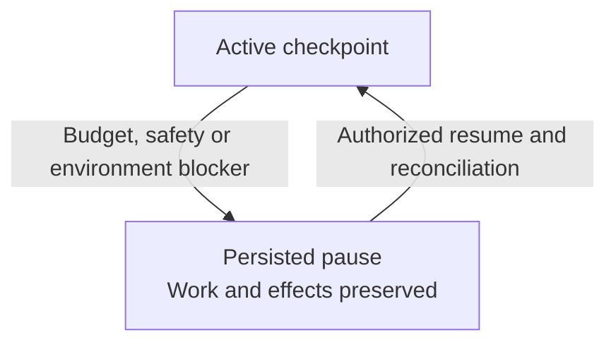
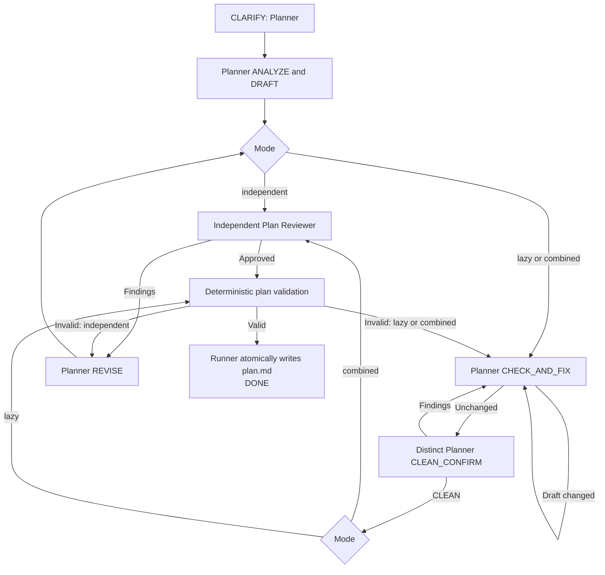
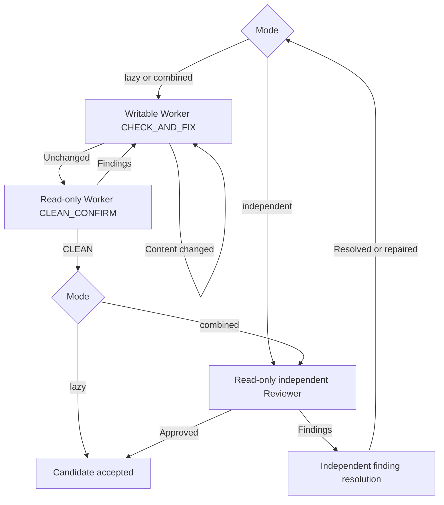
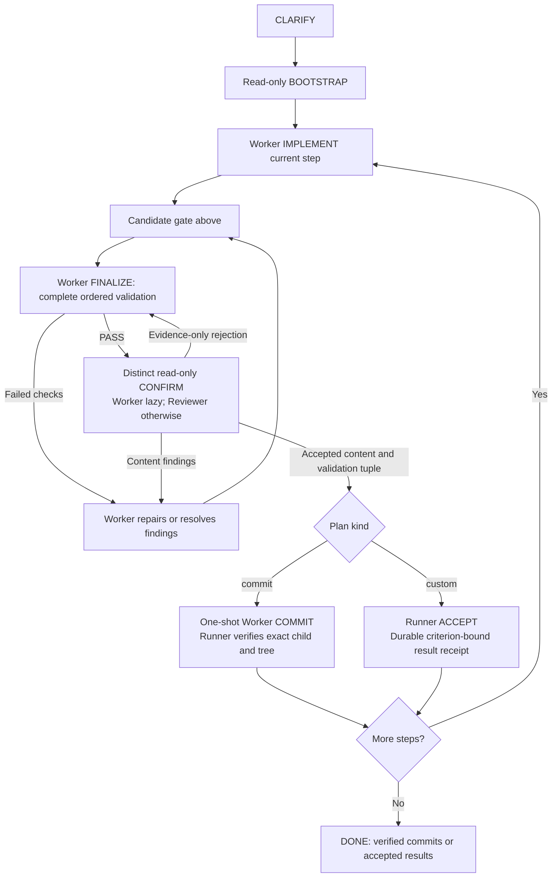
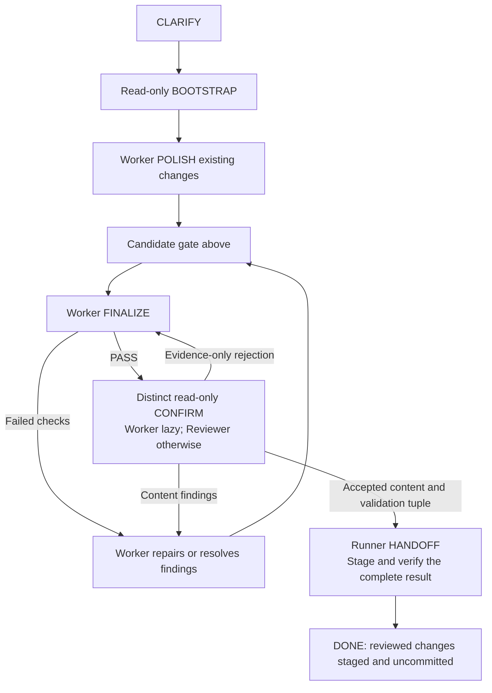
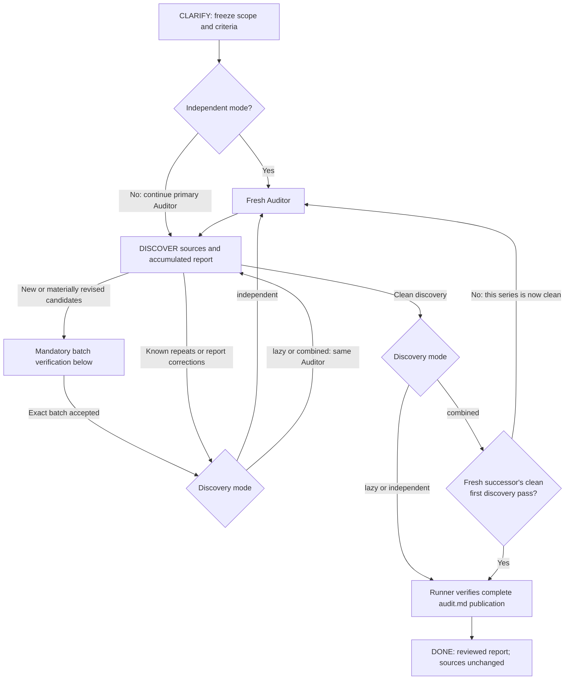
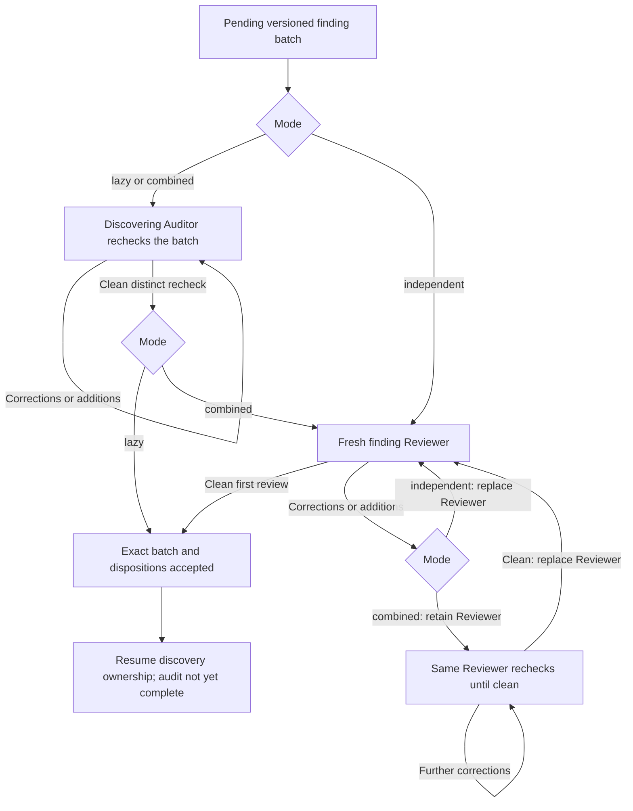
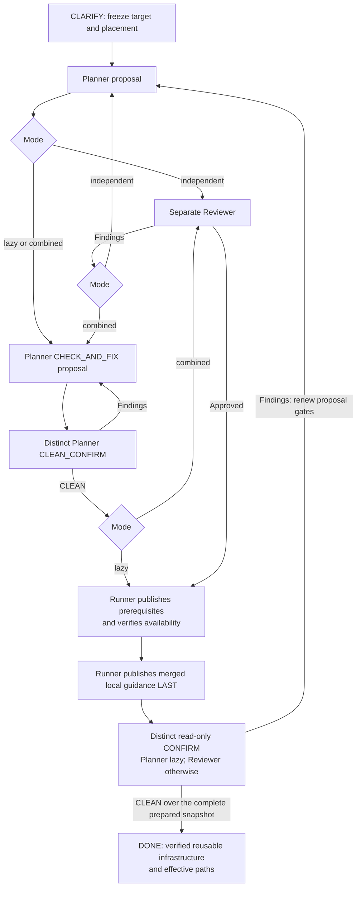

# Pipelines

| Pipeline         | Purpose                                                                                         | Source checkout specification           |
| ---------------- | ----------------------------------------------------------------------------------------------- | --------------------------------------- |
| `plan-authoring` | Analyze a task, review a draft, and atomically write `plan.md`                                  | `pipelines/plan-authoring/docs/SPEC.md` |
| `plan-execution` | Execute reviewed commit steps or criterion-driven custom results                                | `pipelines/plan-execution/docs/SPEC.md` |
| `audit`          | Inspect an agreed Git or ordinary workspace read-only and publish reviewed `audit.md`           | `pipelines/audit/docs/SPEC.md`          |
| `polishing`      | Polish, finalize, review, and stage existing dirty-worktree changes for a later commit workflow | `pipelines/polishing/docs/SPEC.md`      |
| `init`           | Prepare reviewed integrated or external infrastructure without committing                       | `pipelines/init/docs/SPEC.md`           |

Plan authoring and execution share the deterministic
`@agent-runner/commit-plan` contract. The authoring pipeline produces that
artifact and the execution pipeline consumes it.
Polishing is independently owned and operates directly on the current workspace
change set.

The separate `@agent-runner/custom-plan` package defines criterion-driven
`Step N` plans, including analysis-only results.
Explicit custom authoring and sequential execution are available through CLI/MCP/configuration. Custom completion produces accepted result receipts, including analysis without a file diff; it never stages or commits.

In the source checkout, start at `packages/commit-plan/README.md` and
`packages/custom-plan/README.md`.

In a standalone installation, read the bundled contracts at
`node_modules/@agent-runner/commit-plan/contract.md` and
`node_modules/@agent-runner/custom-plan/contract.md` from the application
package root. Specification paths and section references refer to the matching
source checkout.

Git-based snapshots, fingerprints, measurement and source selection/projection
reject HEAD/index gitlinks (including submodules) and non-ignored embedded
repositories with `ERR_UNSUPPORTED_GIT_PATH`. Deleting a gitlink's worktree or
excluding its path does not make it supported. Observation never runs Git inside
these nested candidates; rejection blocks acceptance without changing content
or granting recovery effects. Ignored untracked trees remain pruned. Ordinary
content and confined replacements stay supported, as do read-only nested
worktrees in Git-independent directory workflows. See the
Git safety contract (`docs/product/SAFETY_MODEL.md#git-ownership`).

The diagrams below show the normal gates; the specifications above own exact
recovery and finding-resolution rules. `independent` remains the default and
recommended mode. `lazy` uses only the primary role, with no independent review;
`combined` requires primary convergence before its independent gate.
The checkout's `docs/product/PIPELINE_MODEL.md#review-modes` owns the mode contract.

Every pipeline starts with read-only clarification. Material questions stay in
`CLARIFY`; an empty artifact is valid. Runner freezes the accepted transcript
before work. Ordinary questions then close; only an otherwise blocking unresolved
material product requirement can enter `PRODUCT_DECISION_REQUIRED`.

These pause boundaries apply throughout the diagrams:



Resume preserves mode, counters and consumed effects; it does not renew budgets
or replay a possibly completed commit or publication. Primary clean confirmation
requires structured `CLEAN`; all read-only gates require no mutation and the
unchanged inspected fingerprint.
Logical roles can continue a native session or reconstruct from durable state;
reconstruction grants neither new authority nor independent review. A deliberately
supplied source is forked once for the lazy primary, or separately by relevant
primary/review checkpoints in independent and combined modes. Fresh reviewers
receive frozen inputs and bounded structured evidence, never another role's chat.

### Plan authoring

Authoring returns a reviewed `plan.md`.
Commit plans carry exact validated Conventional Commit subjects; explicit custom
plans carry agreed criteria, observable results and frozen input/output
declarations. Sources stay read-only; declarations grant no authoring writes or
retrieval. All agent turns are repository-read-only and return structured drafts.
Only Runner writes the artifact after deterministic validation.



Planner corrections continue the planning checkpoint; independent review has its
own checkpoint. Combined Reviewer revisions restart Planner convergence. Only
bounded independent finding resolution can use a fresh Arbiter; self-confirmation
and structural exhaustion pause without arbitration. Authoring never implements
the plan or creates a commit.

### Candidate gates for execution and polishing

Execution and polishing establish validation read-only in `BOOTSTRAP`: Worker and
Reviewer independently in independent/combined modes, Worker alone in lazy mode.
Their candidate gate precedes finalization:



Combined primary confirmation and independent approval bind the same candidate.
Self-findings return directly to fixing, without Reviewer or Arbiter. Independent
findings retain bounded fix, withdrawal, dispute, fresh arbitration and exact
recorded override routes. Resolved findings re-enter the selected candidate gate
even when content is unchanged. Combined bootstrap disagreements and primary exhaustion
pause without arbitration. Every content repair invalidates dependent candidate,
finalization and terminal-confirmation evidence and restarts the selected gate.

### Plan execution

Execution consumes the frozen plan in
order. Commit execution requires an initial content change and completes each
step with one verified local commit using its exact heading subject, without a
body or footer. Explicit custom execution can accept analysis without a diff:
agreed criteria and inspected outputs bind a durable accepted-result checkpoint,
with no staging or Git authority even inside a repository.



Independent/combined Worker and Reviewer work checkpoints are fresh for each
step and continue within it; lazy retains one logical Worker and its source-fork
lineage across the run. Finalization may format the accepted candidate; terminal
confirmation covers that resulting fingerprint and the complete validation tuple.
An unchanged resolution can reuse still-current finalization only after the
required candidate gates and fresh fingerprint checks. Consumed effects settle
by verification before another step; a conflicting clarification requires a
revised plan and new run, never rewritten completed history.

### Polishing

Polishing starts with an existing nonempty
change set. It uses the same candidate gates, then finalizes and confirms the
whole result. Worker and Reviewer checkpoints remain separate; lazy continues
the logical Worker. No agent turn can change the index.



Finalization remains staging-independent. Its resulting fingerprint and evidence
require terminal confirmation, including formatter output. Unchanged resolutions
can reuse only current finalization after reconvergence; content repairs renew
the gates. Runner alone stages at `HANDOFF`; `HEAD` stays unchanged and no commit
is created.

### Audit: discovery and finding verification

Audit reads agreed Git or ordinary-directory
sources and accumulates a structured report. All Auditor and finding Reviewer
turns are read-only. Corrections change the report, never the audited project.
The same mode names govern audit-specific discovery sessions:



A finding-producing `COMPLETE` pass can finish one coherent, usable batch while
later passes continue scope inspection. Use concise supported evidence and
targeted reads; candidates contain only new findings or material revisions,
without repeating the accumulated report. Existing result and collection limits
apply without a finding quota or additional batch cap. Every material batch
blocks further discovery until verified.
`INCOMPLETE` work supplies no adopted candidates or report changes.

Clean discovery requires complete agreed-scope inspection with no candidates or
substantive report corrections; the accumulated report may contain findings.
Independent uses a fresh Auditor each pass and needs no redundant
unchanged-response turn after clean discovery. Combined always replaces the
initial Auditor after its series becomes clean. A fresh successor that finds
anything finishes its own lazy series before replacement; its later clean pass
cannot complete the audit. For example:

```text
Auditor 1: findings -> verification -> further discovery -> clean
Auditor 2 (fresh): findings -> verification -> same-Auditor discovery -> clean
Auditor 3 (fresh): clean first discovery pass -> complete publication
```

Every new/material finding batch suspends discovery for this separate gate:



Rechecks confirm, correct, reject, merge or retain an unverified hypothesis;
changed versions and review additions need verification themselves. Rejected
decisions remain durable and never retroactively make discovery clean. A clean
batch review accepts only that batch, not discovery or the audit. Combined
requires same-Auditor convergence followed by a fresh Reviewer's clean first
pass; a correcting Reviewer finishes its own series before replacement.

Discovery and finding rechecks have separate run-wide budgets, each capped at
20, including across sessions and reconstruction. Invalid or interrupted turns
cannot establish cleanliness or renew either budget. Exhaustion pauses resumably
with the draft and pending verification preserved; reconstruction creates no
fresh-first-pass opportunity. Runner alone publishes `audit.md`, including an
in-progress draft after accepted updates. Only current versions with exact
accepted receipts appear confirmed; pending candidates and
hypotheses stay explicitly unverified. Completion requires the selected discovery
gate, no pending verification, unchanged bindings and verified complete publication.
Zero or Critical findings can accompany success. Findings grant no fixes, Git
effects or automatic issue creation.

### Init

Init freezes target-bound integrated or external
placement independently of review mode. Planner proposals and every review or
confirmation turn are read-only; Runner publishes the reviewed resources.
Proposal acceptance alone does not mean infrastructure is available.

Rejected semantic results expose a finite constraint, original code and fixed
corrective guidance. Same-checkpoint resume/reconstruction receives matching
feedback; rejected resources remain unpublished and the last valid proposal is
preserved. Acceptance or a product decision clears feedback without renewing
budgets. See init semantic rejection (`pipelines/init/docs/SPEC.md#semantic-result-rejection`).



Primary corrections continue their logical owner; Reviewer remains separate in
independent/combined modes. Revisions invalidate dependent approvals and preserve
bounded accounting. Integrated placement preserves existing skills and unrelated
settings; external placement leaves the target and Git controls unchanged.
Completion verifies prerequisites, guidance and the complete prepared snapshot;
it does not claim the prepared finalization procedure was executed. Setup never
stages, commits or starts another pipeline, and interrupted publication reconciles
its exact intent and receipts before continuing.

## Pipeline Boundary

The init pipeline prepares reviewed integrated or
external infrastructure. All agent turns are read-only. Runner publishes
prerequisites, verifies availability, publishes merged local guidance LAST and
requires a distinct terminal confirmation before reporting completion. Setup
never stages, commits or starts another pipeline. Both placements support all
three modes; independent remains recommended.

```bash
agent-run run init --project /path/to/project --task /path/to/external-task
agent-run run init --project /path/to/project --task /path/to/external-task --placement external --mode combined
```

The external task supplies `task.md` and optional `context.md`. MCP uses
`run_start` with `pipelineId: "init"`, `projectPath`, `taskPath`, optional
`placement` and independent `mode`. Status returns created/reused/changed
resources, working-directory assumptions and the exact reusable configuration
selector. Use it in later runs with CLI `--project-config` or MCP
`projectConfigurationPath`. External setup leaves target files and Git controls
unchanged, needs no pointer/global registration, and references existing project
skills without editing them. Explicit placement migration preserves the old
setup. Reruns preserve useful guidance without duplicate setup metadata;
interrupted effects reconcile their original identities before continuing.
Expected init inspection failures persist an actionable pause before execution
ownership is released, including rejection before any provider attempt. CLI and
MCP status/wait report the same phase, constraint and supported recovery. Only
transient inspection failures permit unchanged-input resume; other diagnoses
require preserving work, correcting prerequisites and a fresh run. Start/resume
receipts acknowledge admission/dispatch, not successful setup. See
inspection recovery (`pipelines/init/docs/SPEC.md#inspection-failures`).
Semantic result rejection exposes matching finite corrective feedback in status,
waits and the resumed role request; see
semantic rejection (`pipelines/init/docs/SPEC.md#semantic-result-rejection`).
Terminal provider failures persist `FAILED` with bounded diagnosis before owner
release. Foreground CLI exits unsuccessfully; status and held/new waits expose
the same outcome. Preserve prepared resources and use separately authorized
follow-up; see init failures (`pipelines/init/docs/SPEC.md#terminal-provider-failures`).
The managed guidance includes the exact selected finalization procedure.
Interrupted reconstruction pauses resumably at its saved checkpoint and retains
the consumed recovery allowance.

The pipeline registry is static in V1. A pipeline descriptor exports an ID, a
state version, roles, configuration settings and defaults, setting allowed values and
recommendations, descriptor-owned active-role selection, ordered migrations
from supported prior versions, pipeline-specific accepted and required `run`
options, task-input definitions, clarification and status projections,
resume-action validation, persisted-run validation, and a description; the root
CLI owns the common `--clarify` lifecycle option. Each workspace owns its
explicit JavaScript workflow. The runner provides state, events, agents, and
Git services; pipeline workspaces own mode and workflow policy.

Audit is runnable through `agent-run run audit --project <workspace> --task
<task-dir>` or MCP `run_start` with `pipelineId: "audit"`. Supply `task.md` and
optional `context.md`; agreed scope includes unchanged content unless explicitly
limited. It supports Git and ordinary directories, all three modes, and an
independent default/recommendation. Auditor and finding Reviewer always remain
read-only. Combined uses distinct discovery and finding-review cycles; see the audit specification above.

Audit defaults to whole-directory inspection, including ignored content. Select
complete Git working-tree sources explicitly, or prune literal directory subtrees:

```bash
agent-run run audit --project /workspace/project --task /workspace/task --source-scope git
agent-run run audit --project /workspace/project --task /workspace/task --exclude-path generated --exclude-path cache
```

MCP `run_start` accepts matching `sourceScope` and `excludePaths` fields. Git scope
includes unchanged and ignored tracked files, dirty/deleted tracked paths and
non-ignored untracked sources; it retains read-only directory permissions and
grants no Git effects. Exclusions require directory scope and are confined literal
paths, without glob expansion. They are pruned before discovery, hashing and
provider preparation and cannot overlap required inputs, configuration, artifacts,
controls or link dependencies. Settings and membership freeze before capture;
clarification cannot expand them. Changed selection or membership requires a new
run. CLI status and MCP `auditSource` expose the selection; new reports include
the frozen scope and literal exclusions. Legacy runs retain whole-directory
bindings, historical reports and consumed budgets.

Audit publishes its run ID before recursive preparation. CLI activity shows
status, pause and cancel commands immediately; MCP `run_start` acknowledges
owned detached preparation while capture continues. Status exposes pending
`workspacePreparation` in `CLARIFY`. Pause/cancel can interrupt capture before
provider work; resume uses the frozen inputs/configuration under the same
canonical exclusion. Client wait cancellation leaves detached work running.

Runner publishes `<task-dir>/audit.md` as work progresses. Only rechecked findings
appear confirmed; pending candidates and hypotheses remain explicitly unverified.
Completion requires the selected clean-discovery gate, no pending batch and
unchanged bindings. Both budgets are run-wide and capped at 20, including after
interruption. Status exposes the report path/status/hash and finding/pass counts.
Invalid role results expose bounded field diagnostics in CLI/MCP pause evidence;
resume supplies structured correction feedback within the existing pass budgets.
Terminal provider failures retain validated class evidence in status, wait and
safe activity; they grant no same-run audit resumption. See the
audit failure contract (`pipelines/audit/docs/SPEC.md#read-only-discovery-lifecycle`).
Zero or Critical findings can accompany success; findings create no automatic
issues or repair permissions. Unavailable evidence remains visible. Report
publication resumes without replaying accepted model work; unexpected report edits
fail closed. A saved rendering the current runtime cannot reproduce, or report
temporary custody that cannot be verified, pauses with no continuation while the
durable checkpoint is retained; preserve `audit.md` and any remaining
`.audit.md.tmp`. Repository-local task artifacts must already be ignored and untracked.

The Git/state boundaries preserve unfinished work outside the repository and
transient validation storage. Newly eligible execution runs use their verified
capture and journaled restoration to separate reviewed replacement commits;
saved future work survives interruption, commits and cancellation. See the architecture contract (`docs/architecture/work-preservation.md#capture-and-restoration`).
